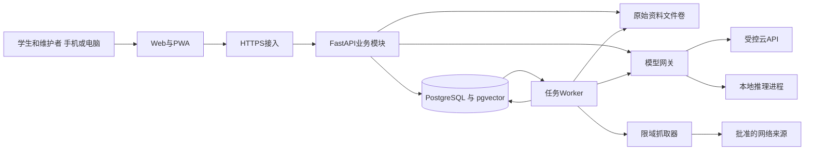
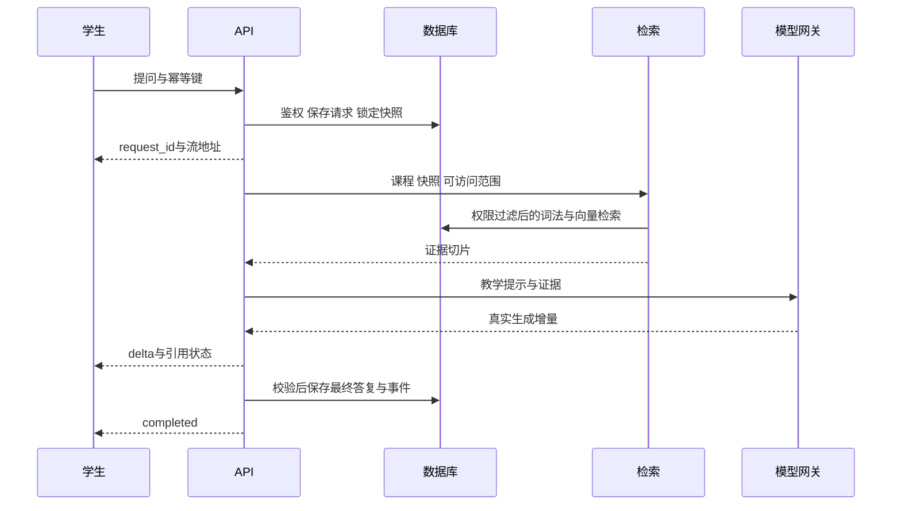

# 系统总体架构与模块设计

## 架构选择

采用模块化单体后端加独立后台任务进程。初期以一个后端代码库、一套数据库和一个前端交付，减少课程作业的运维负担。推理进程从Web进程分离，避免模型加载、长时间生成和索引任务阻塞用户请求。暂不引入微服务、图数据库或专用向量集群。

| 层级 | 推荐组件 | 职责 |
|---|---|---|
| 客户端 | Vue 3、TypeScript、Vite、响应式PWA | 课程切换、问答、学习面板、更新中心 |
| 接入层 | Caddy或等效反向代理 | HTTPS、静态文件、流式透传、请求限制 |
| 应用层 | FastAPI、Pydantic、SQLAlchemy、Alembic | 鉴权、业务规则、API、数据库迁移 |
| AI编排 | 自有服务接口，复用LlamaIndex适配能力 | 检索、提示词、引用、模型能力适配 |
| 数据层 | PostgreSQL、pgvector、受控文件卷 | 业务真相、向量、原始资料 |
| 后台层 | PostgreSQL任务表、独立Python worker | 导入、收集、诊断、摘要和导出 |
| 模型层 | API提供商或本机Ollama，GPU场景可用vLLM | 对话、嵌入、可选重排、结构化输出 |

选型是设计建议，依赖版本在实施时锁定并做集成测试。pgvector提供PostgreSQL内的向量检索能力，适合本项目合并存储的设计；权限过滤与近似检索召回仍需共同测试。[官方说明](https://github.com/pgvector/pgvector)

## 组件关系

## 模块职责与边界

Identity处理登录、会话、课程成员及权限。Course管理课程和知识点先修图。Knowledge维护资料、版本、切片、来源和快照。Chat仅组织本课程对话，调用Retrieval与ModelGateway，不能自行越过权限检索。Assessment管理题目版本、作答和评分量规。Learning记录事件并构建掌握度、误区和复习投影。Update负责来源收集与审核发布。Notification只创建站内收件项。Ops管理任务状态、运行模式和审计。

各模块通过应用服务调用；数据库可共用但禁止绕过所属模块直接修改关键状态。KnowledgePublisher是唯一能切换已发布快照的服务；LearningProjector是唯一能修改学习投影的服务。模型输出不能直接执行SQL或修改发布状态。

## 问答顺序与一致性

问题入库和任务创建用同一事务。先返回请求对象，再订阅SSE；前端断线重连不会再创建生成任务。一个请求固定一个知识快照、提示词版本和模型路由；新发布资料只影响后续请求。资料因安全原因撤回时，即使快照固定也必须经过实时撤回过滤。

## 异步任务

任务表保存payload、状态、attempt、run_at、lease_until、dedupe_key、错误码和检查点。Worker用行锁与SKIP LOCKED认领任务，默认租约60秒，每20秒续租。失联租约过期可再领取，处理采用至少一次语义；结果以唯一业务键去重。重试间隔初始1、5、30分钟共3次，之后进入failed，维护者手动重试。永久性授权或格式错误直接失败。

核心业务事务同时写入outbox记录，分发器将其转为任务；消费者提交结果时记录已消费事件。数据库提交后进程崩溃也可补发。发送站内通知以用户、发布批次和类型唯一，避免重复提醒。

## 演进与兼容

示例中的资料分组、解析和教学提示思路可复用；现有文件索引应通过导入管道重新解析和生成新向量，不能把pickle当作可信分发格式。旧API如需保留，可暂时映射至新应用服务；不得接受旧请求体中的user_id作为身份。第1周先制作小样验证解析、中文检索、手机SSE和本地模型，再扩大功能。
