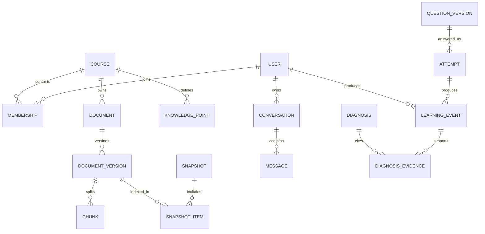

# 数据模型与一致性设计

## 通用约定

主键用UUID，时间以UTC保存并按用户时区显示，中文全文用UTF-8。业务表通常含created_at、updated_at与revision。所属课程资源具有course_id；私人资源同时带owner_id。成员身份从服务端会话获得，客户端不能指定生效的用户身份。跨表引用应以(course_id,id)复合外键或等价约束防止串课。

软删除用于短期恢复，物理清除由删除任务完成。软删除行必须立即从业务查询和检索排除。原始作答和学习事件保留版本，纠错采用追加更正事件；不能覆盖历史导致诊断证据失真。

## 实体关系

## 逻辑表与关键字段

| 表 | 核心字段 | 约束与索引 |
|---|---|---|
| users | id、login_name、password_hash、status | login_name唯一；密码使用专用慢哈希 |
| sessions | id_hash、user_id、expires_at、revoked_at | 仅保存令牌摘要，过期索引 |
| courses | id、name、domain、settings、active_snapshot_id | 活动快照必须属于本课程 |
| memberships | user_id、course_id、role、status | 联合唯一；角色student/maintainer/admin |
| knowledge_points | id、course_id、code、label、rubric_version | (course_id,code)唯一 |
| prerequisite_edges | course_id、before_id、after_id | 禁止自环，应用层检查环路 |
| documents | id、course_id、owner_id、visibility、status | visibility为course或private |
| document_versions | id、document_id、sha256、storage_key、origin_url、license、parser_version | (document_id,sha256)唯一；不可变 |
| chunks | id、course_id、document_version_id、ordinal、text、locator、token_count | (document_version_id,ordinal)唯一 |
| embedding_spaces | id、provider、model_revision、dimension、normalization | 指纹唯一，不能混合空间 |
| chunk_embeddings | chunk_id、space_id、vector | 联合唯一；按空间分区与建向量索引 |
| snapshots | id、course_id、space_id、state、published_at | state为building/ready/active/retired |
| snapshot_items | snapshot_id、document_version_id | 联合唯一；固定文档版本集合 |
| conversations | id、course_id、user_id、title | (user_id,course_id,updated_at)索引 |
| generation_requests | id、conversation_id、user_id、key、status、snapshot_id、route_version | 用户+key唯一；同键异体返回409 |
| messages | id、conversation_id、request_id、role、content、status | request+assistant角色唯一 |
| citations | message_id、chunk_id、claim_id、locator、check_status | 引用必须属于该请求可访问快照 |
| question_versions | id、course_id、question_id、type、prompt、answer、rubric、kp_weights | 版本不可变；答案不下发到作答页 |
| attempts | id、user_id、course_id、question_version_id、answer、hint_level、score、review_status | client_submission_id按用户唯一 |
| learning_events | id、user_id、course_id、type、entity_id、occurred_at、received_at、schema_version、payload | 用户+client_event_id唯一 |
| mastery_states | user_id、course_id、kp_id、alpha、beta、effective_n、algorithm_version | 联合唯一；可由事件重建 |
| diagnoses | id、user_id、course_id、kp_id、type、state、rule_version、counterevidence | 状态迁移受应用约束 |
| diagnosis_evidence | diagnosis_id、event_id、weight、reason | 联合唯一；必须同用户同课程 |
| review_tasks | id、user_id、course_id、kp_id、due_at、state、source_diagnosis_id | 查询(user_id,due_at,state) |
| source_configs | id、course_id、url、allowed_hosts、schedule、enabled、last_success_at | (course_id,canonical_url)唯一 |
| update_candidates | id、source_id、content_hash、diff、review_status、review_revision | (source_id,content_hash)唯一 |
| releases | id、course_id、snapshot_id、summary、status、revision | 活动发布通过课程指针确定 |
| notifications | id、user_id、release_id、read_at、kind | (user_id,release_id,kind)唯一 |
| tasks / outbox | id、type、dedupe_key、payload、status、run_at、lease_until | dedupe_key唯一；run_at索引 |
| audit_logs | id、actor_id、action、resource_id、trace_id、result、at | 追加写；正文与密钥不得入日志 |
| model_routes | id、version、policy、capabilities、secret_ref、adapter_revision | 密钥为引用，普通接口不可回显 |
| export_jobs / deletion_jobs | id、user_id、state、expires_at、storage_key | 下载需二次鉴权与短期签名 |

这是逻辑模型；正式迁移需落实所有外键、NOT NULL、枚举检查、唯一约束与RLS策略。JSON字段不能替代关键权限和状态字段。向量维度随空间固定，各空间可采用独立物理表，不能把不同维度直接写入同一固定维度列。

## 定位与版本

PDF定位包含页码和可选bbox，DOCX与Markdown包含标题路径、段落序号和字符范围。网页含规范URL、抓取时间、原始内容哈希和段落序号。没有页码的资料不能显示虚构页码。资料更新生成新版本，历史答案引用旧版本并标注“已有新版”；授权撤回时隐藏原文，只保留允许保留的元数据。

## 事务与并发

1. 发布事务校验审核版本、快照就绪、嵌入空间匹配，使用课程revision做乐观锁，一次切换active_snapshot_id并写outbox。并发发布者得到409后重新比对。
2. 作答事务保存attempt、评分版本与learning_event；异步诊断失败不能丢失作答。
3. 学习投影以(user_id,course_id)串行或锁行更新，processed_events登记与投影同事务；重复事件不重复计分。
4. 时间乱序事件按occurred_at重放，received_at记录接收顺序；设备时钟偏差超过5分钟则标记并以服务端时间参与日程，不盲信客户端时间。
5. 删除事件触发原文、向量、缓存、导出文件与投影清理；新查询立即拒绝，后台清理可重试。

## 隔离与留存

服务端显式过滤加RLS纵深防护；连接池每个事务用SET LOCAL设置已认证主体，事务结束自动清理上下文。应用运行账号非表所有者、非superuser、无BYPASSRLS；迁移账号分离。RLS启用后无策略默认拒绝，但表所有者等例外必须显式处理。[PostgreSQL文档](https://www.postgresql.org/docs/current/ddl-rowsecurity.html)

初始项目政策：学习记录默认保留180天，可导出后删除；诊断与证据同生命周期；运行日志30天；非正文审计90天；备份30天滚动。上述是设计默认值，不是法律结论。删除请求7天内完成在线物理清理；备份随周期过期，恢复后必须重放删除清单再开放服务。
