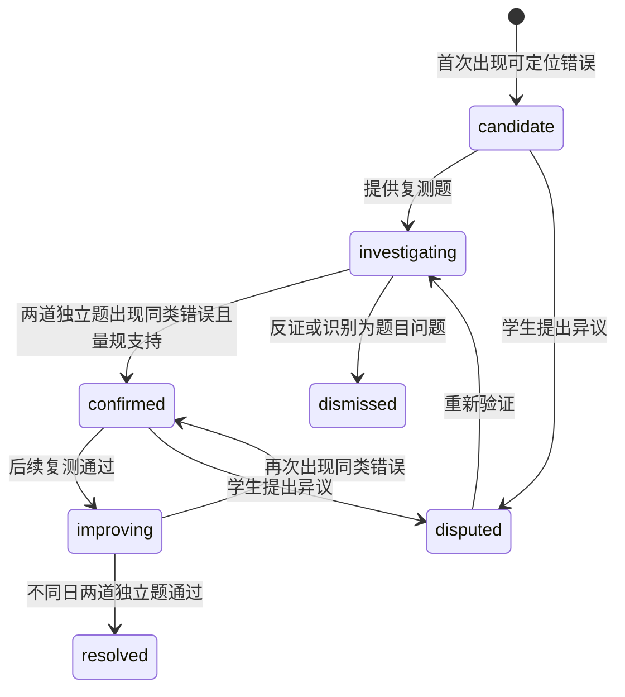

# 学习记录与误区诊断设计

## 教育含义与限制

系统记录具体学习行为，提出可验证的学习假设。学生提问、阅读时长和聊天次数可说明兴趣或参与情况，不能单独说明知识掌握或概念误解。潜在问题限于课程知识、先修基础、方法和易混概念，不推断心理健康、智力或人格。

数学、语言和文史课程的评价方式不同。客观题用题库规则；计算题用步骤量规并允许教师复核；开放问答提供“建议评价”。没有经过审核量规的主观题结果不进入高置信诊断。

## 事件词典

| 事件 | 必备业务字段 | 用途 |
|---|---|---|
| question_asked | conversation_id、message_id、kp_tags | 主题关注与推荐，不计掌握 |
| explanation_viewed | message_id、visible_duration_bucket | 体验统计，可关闭，不计掌握 |
| attempt_submitted | attempt_id、question_version、kp_weights | 诊断证据原始入口 |
| assessment_finalized | attempt_id、score、rubric_version、hint_level、review_status | 掌握度有效证据 |
| hint_requested | attempt_id、level | 区分独立完成与提示完成 |
| diagnosis_disputed | diagnosis_id、reason | 停止直接使用争议标签并触发复核 |
| review_completed | review_task_id、attempt_id | 间隔复习调整 |
| correction_applied | original_event_id、replacement_event_id、reason | 重建投影和诊断 |

公共信封包括event_id、client_event_id、user_id（服务端注入）、course_id、occurred_at、received_at、schema_version。前端只能提交交互类事件；评分和assessment_finalized只能由可信后端生成。payload不重复保存完整聊天正文，引用业务实体即可。

## 可解释的掌握度基线

首版采用可重建的Beta证据累计，属于启发式学习指标，未校准前不称为真实掌握概率。每个知识点alpha=1、beta=1，暂无证据时不显示50%为能力评分。

对经审核有效作答，得分s归一化至[0,1]，知识点权重w来自题目映射并且每题权重之和=1；证据质量q为独立完成1.0、轻提示0.6、已见答案后的重做0.2，未复核主观题为0。更新alpha+=w*q*s，beta+=w*q*(1-s)，展示指数alpha/(alpha+beta)并同时展示effective_n=sum(w*q)。

同一原题族每日累计q上限1，避免反复刷同题抬高指标；不同知识点不得各记一整道题。effective_n<3时只显示“证据较少”。初始区间为<0.4需补基础、0.4至0.7继续练习、≥0.7较稳定，均需开发集调整。不根据不活跃天数直接降低能力值；时间衰减只影响复习优先级。

提示等级由后端已经发出的提示与答案展示记录决定，不能仅相信客户端声明。若学生主动报告使用外部提示，可降低证据权重；系统不声称能检测所有外部辅助行为。

示例：一道概念题独立答错，w=1、q=1，指标从先验0.5变为1/3，但effective_n=1，界面只显示“有一次待复测记录”，不直接贴“不掌握”标签。换题独立答对后alpha=2、beta=2，仍需更多证据。

## 误区状态机

独立题指不同原题族，不是同题改几个数字。模型可以建议误区类型，但服务端规则决定状态。知识点映射不确定、题目答案有争议或评分待复核时，只允许candidate。误区记录包含错误描述、证据attempt_id、反证、量规版本、算法版本、验证题和最后更新时间。

候选文案：“你在两道题中都把相关关系解释为因果，可能需要区分这两个概念。做一道验证题看看。”不显示未经校准的置信百分比。学生可标记“我只是看错题”“评分有误”“已理解”，这些反馈触发复核，而不是直接删除证据或自动确认掌握。

## 潜在问题推断

对当前难点沿课程先修图最多向前两层寻找低证据或表现不稳定的知识点，以规则给出一至三个待验证假设。先修图由维护者审核，禁止模型自行改图。假设需要说明来源，例如“函数复合连续出错，可能与映射概念有关”，并给短诊断题。先修点无作答记录时标为未知，不能判定薄弱。

不使用复杂知识追踪模型作为首版必要依赖。后续可将规则与BKT等方案做离线对比，但必须先验证数据足够、指标适用和学生分组公平性。

## 复习计划与纠错

初始复习间隔1、3、7、14天；完成复习答错回到1天，独立通过进入下一档，提示完成维持当前档。每天最多推荐3项、约15分钟，允许改期和暂停。间隔是产品初值，不能宣称最佳学习策略。修改题目答案或评分量规时发更正事件，重算受影响投影，旧诊断显示“已因评分更正更新”。

诊断Worker只读取当前用户当前课程最小证据。处理失败保持“学习记录已保存，分析稍后更新”；消息页不得先显示最终误区再在失败时丢失证据。
