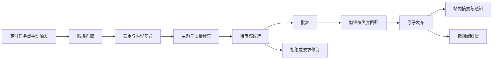

# 网络知识收集与发布设计

## 目标与来源

定期收集课程相关的新资料，向维护者提交可审查差异，发布后向学生提交简明更新。首版站内通知足够完成需求，邮件和手机推送可后续增加。

维护者为每门课程配置来源URL、允许域名、RSS或网页抓取方式、主题标签、频率、内容许可、每日数量与最后成功时间。优先RSS、官方文档、开放教材和课程负责人提供页面。搜索发现可作为后续扩展，不依赖全网开放抓取。不能绕过登录、付费墙或来源限制；网页可访问不代表可整篇转载。

## 状态与调度

每课默认每日本地时间02:00检查，来源每轮最多20页、抓取超时15秒、总任务上限5分钟；每域名每秒不超过1次。调度保存时区和下次UTC时间；相同来源同一天的任务dedupe_key唯一。错过计划后恢复只补跑一次最新检查，避免堆积。失败按1、5、30分钟重试，三次失败标记并展示最后成功时间。学校网络不可达时继续使用现有知识库。

## 差异与相关性

URL规范化去除跟踪参数但保留会改变正文的参数；同URL不同正文创建新候选，同正文不同URL记录别名。先比较ETag或Last-Modified，随后用净化正文SHA-256确认；只改导航和广告不创建知识更新。保存抓取时间、原始页面哈希和提取器版本，以便复现。

检查课程关键词、知识点映射、来源可信度、发布日期与内容有效期。模型只提供相关性和摘要建议；涉及公式、答案、政策、事实冲突需要人工核对。与教材冲突时并列展示旧说法、新说法和来源，不自动覆盖。对于文史等存在多种解释的课程，保持出处和观点归属，不将“更新”简单等同“旧观点错误”。

## 审核与发布协议

候选状态为discovered、parsed、pending_review、approved、rejected；解析失败为failed，可重试。批准请求必须带review_revision，内容变化后旧批准失效。只有课程维护者能批准。批次内任一关键文件构建失败，整体不发布；维护者可明确移除失败条目后创建新批次。

发布先构建ready快照并运行检索冒烟、引用定位、权限与嵌入指纹检查，再用数据库事务切换活动指针。期间学生始终读取旧版本，禁止读到半个索引。发布与通知通过outbox衔接，通知失败不回滚知识库，重试也不重复发。

用户更新卡示例：标题“统计基础新增相关与因果辨析”，正文包含新增2条、修订1条、涉及知识点、对学习的影响、原始来源、发布日期和资料版本，并提供“查看差异”“去复习”。无实质变化不提醒。摘要不得把模型猜测写成来源已证实内容。

## 撤回和回滚

普通质量问题回滚到上一完整快照，保留撤回记录与原因。版权或有害内容撤回时先把document_version加入全局拒绝检索列表，再清理所有快照、缓存和可见原文；不能只切回仍包含该内容的旧快照。历史答案加“相关资料已撤回”标识，必要时隐藏对应片段并创建更正通知。回滚后执行一次受影响问题回归测试。

## 抓取安全

抓取器仅能访问维护者批准的公网HTTP/HTTPS域名；禁止file、ftp、localhost、私网、链路本地和云元数据地址。每次DNS解析和每次重定向均重新检查，阻止DNS重绑定。限制响应大小和解压比，移除脚本、隐藏指令和可执行内容。抓取环境无数据库管理员权限、无模型密钥、无任意工具执行权限。

外部文档按不可信数据处理，不能授权调用工具、修改权限或自动发布。仅靠提示词或微调不能消除间接提示注入，应配合权限、格式校验和隔离。[OWASP说明](https://genai.owasp.org/llmrisk/llm01-prompt-injection/)
