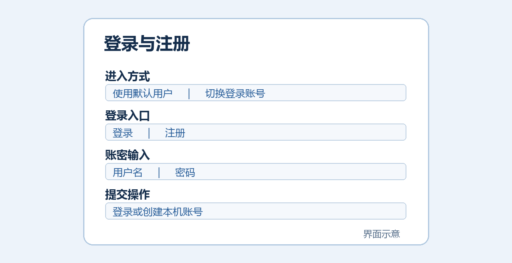
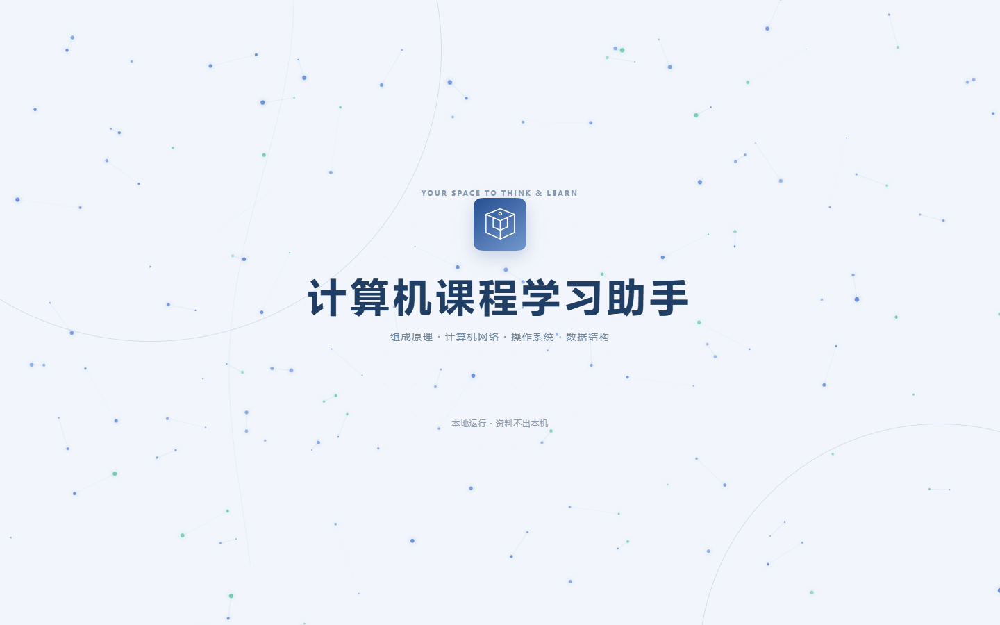
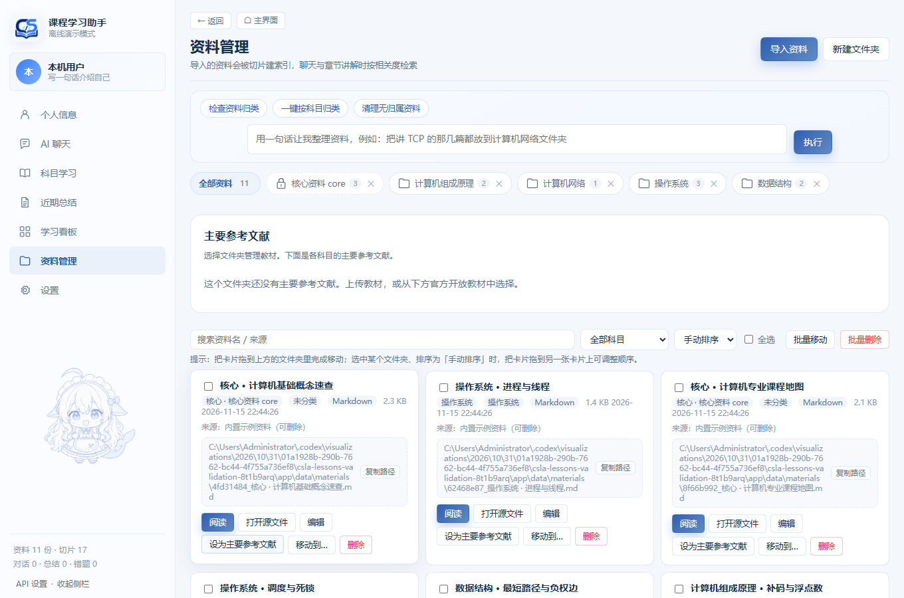
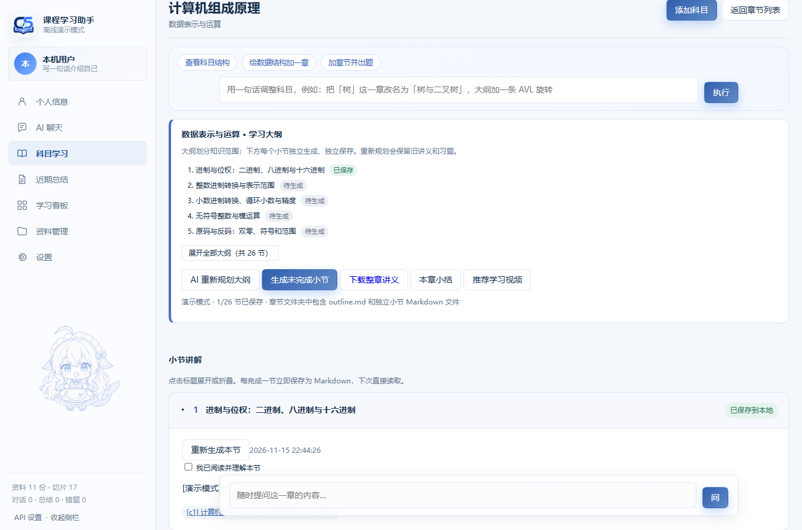
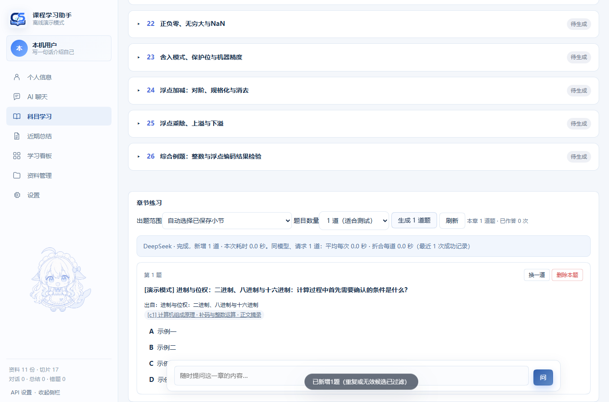
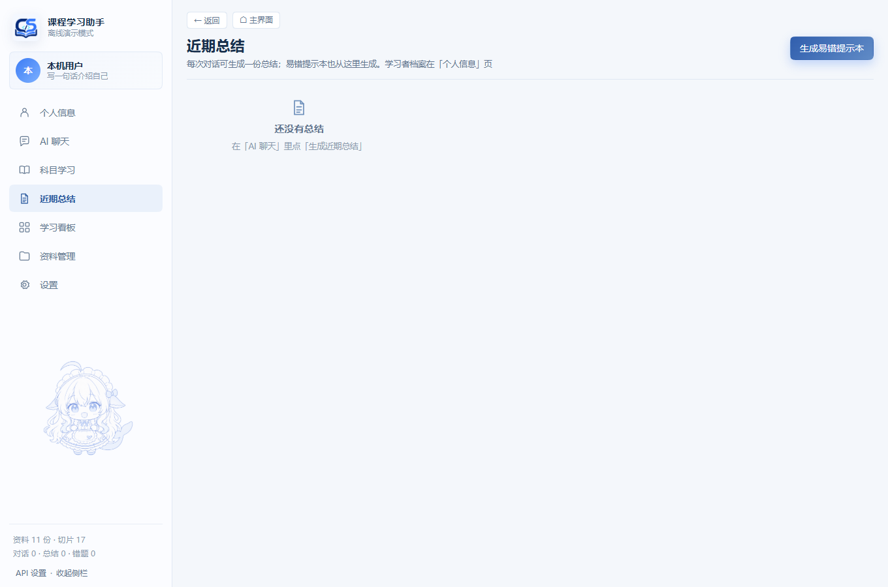
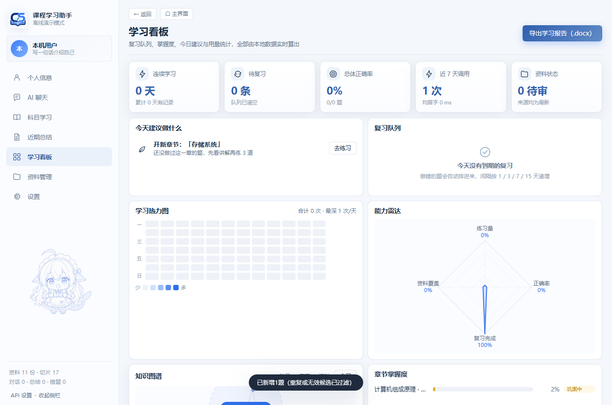
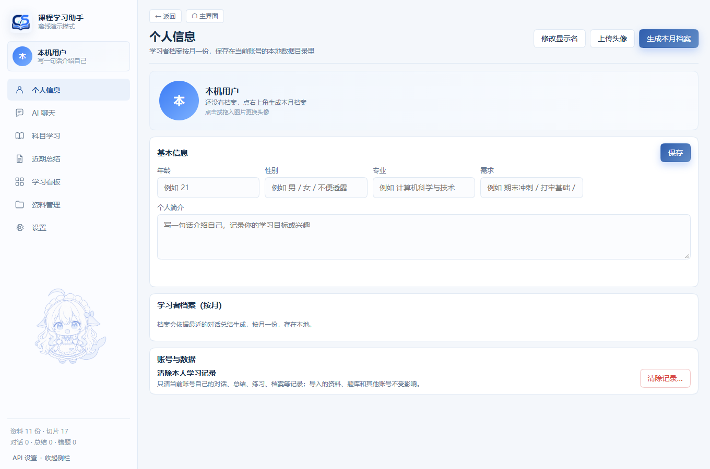
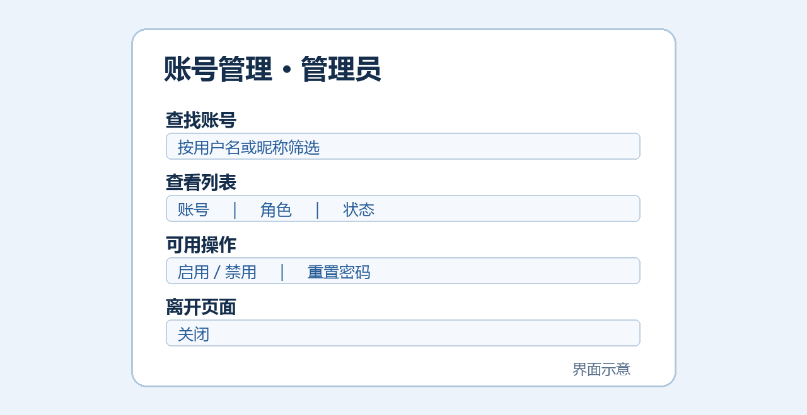
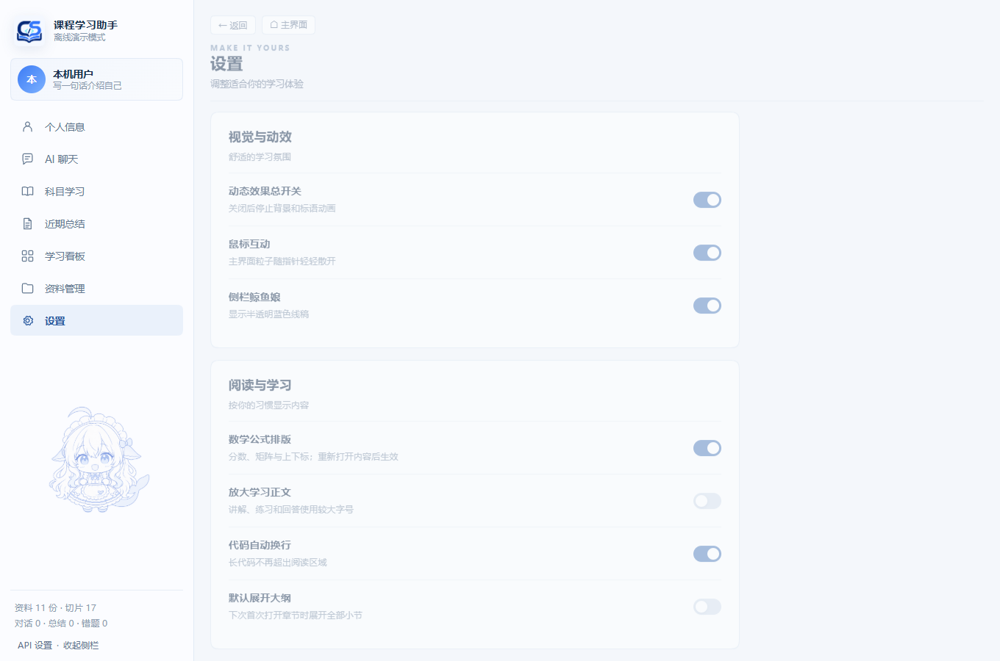

# 06 附录I-2 用户界面设计

计算机课程学习助手

用户界面设计报告

| 文件状态： [√] 送审 [  ] 已批准 [  ] 正在修改 | 文件标识： | CSLA-SD-UI |
| --- | --- | --- |
| 文件状态： [√] 送审 [  ] 已批准 [  ] 正在修改 | 当前版本： | 1.1 送审 |
| 文件状态： [√] 送审 [  ] 已批准 [  ] 正在修改 | 作    者： | 项目组（签署待确认） |
| 文件状态： [√] 送审 [  ] 已批准 [  ] 正在修改 | 完成日期： | 2026-11-23 |

版 本 历 史

| 版本/状态 | 作者 | 参与者 | 起止日期 | 备注 |
| --- | --- | --- | --- | --- |
| 1.0 草稿 | 项目组 | 待评审确认 | 2026-11-02 | 按当前版本填写 |
|  |  |  |  |  |
| 1.1 / 送审 | 项目组 | 项目组 | 2026-11-23 | 同步应用各端的交付内容 |

 目 录 

0. 文档介绍

0.1 文档目的

用页面入口、用户动作和界面反馈说明学生如何完成一次学习。

0.2 文档范围

涵盖桌面布局、浏览器窄屏及安卓原生交互。

0.3 读者对象

项目组成员、指导教师、测试人员及后续维护人员。

0.4 参考文献

[T] 课程资料，原项目文档模板，卓越工程综合训练。

[CODE] 交付基线：fix/android-reliability 提交 cee2b4b，2026-11-22。

[PLAN] 项目组，《附录C-2 项目计划》，课程交付材料。

[LOG] 2026-11-21 与 11-22 修改日志。

[DESIGN] 产品需求、体系结构、模块设计及用户手册。

0.5 术语与缩写解释

| 缩写、术语 | 解 释 |
| --- | --- |
| SPP | 精简并行过程。 |
| SD | 系统设计。 |
| UI | 用户界面。 |
| SSE | 回答和状态的流式事件。 |
| 空状态 | 列表无内容时展示说明与下一步入口。 |

1. 应当遵循的界面设计规范

遵循一致导航、及时反馈、可撤销优先和危险操作确认原则。沿用蓝白主题、圆角卡片与SVG图标；账号密码和API Key分开输入。权限不足时隐藏或禁用写入口，后端仍作最终校验。

2. 界面的关系图和工作流程图

界面编号：UI-01登录注册，UI-02模型设置，UI-03欢迎页，UI-04首页，UI-05聊天，UI-06科目章节，UI-07资料管理，UI-08资料阅读，UI-09总结档案，UI-10看板复习，UI-11个人信息，UI-12账号管理。

桌面先选择默认用户或切换登录。无 Key 可进入资料阅读。手机首次进首页，顶部目录切换模块，系统返回先关闭弹层，再按层级返回。

以复习 TCP 重传为例，先导入课件，再到科目学习打开对应章节，生成大纲和小节讲解，点击出处对照原文，完成练习并复习错题，最后在看板确认阅读和复习进度。

图 1  首页、功能页与章节页之间的导航

图 2  UI-01 登录与注册（界面示意）

图 3  UI-02 模型设置（界面示意）

图 4  UI-03 欢迎页（演示截图）

3. 主界面

主界面左侧按个人信息、AI 聊天、科目学习、近期总结、学习看板、资料管理和设置排列。首页功能卡进入对应模块。

主界面 → 科目列表 → 章节列表 → 大纲与小节 → 练习。点返回回上一层，到功能首页再次返回回主界面。

设置各组纵向排列，适合窄屏阅读。头像可裁剪，欢迎页动画跟随界面偏好。安卓在顶部保留目录和返回入口。

图 5  UI-04 首页（演示截图）

4. 子界面A

子界面A对应UI-07资料管理与UI-08阅读。

资料管理显示文件夹、导入、参考文献及筛选。浏览教材时可检查目录和页码，选择映射生成章节。PDF 引用可跳页。

导入失败时保留原有资料。手机显示传输进度并允许取消，使用系统选择器导入或保存。文字型 PDF 可提取正文。

图 6  UI-07 资料管理（演示截图）

图 7  UI-08 资料阅读（演示截图）

5. 子界面B

章节大纲默认折叠，逐节列出。小节可折叠和单独重生成，支持 Markdown、公式和阅读勾选。题目显示出处，交卷后可看简解或详细解答。看板综合阅读、练习与复习状态。

图 8  UI-05 AI 聊天（演示截图）

图 9  UI-06 科目与章节（演示截图）

图 10  UI-06 章节练习（演示截图）

图 11  UI-09 近期总结（演示截图）

图 12  UI-10 学习看板与复习入口（演示截图）

图 13  UI-11 个人信息（演示截图）

图 14  UI-12 账号管理（界面示意）

图 15  补充 界面偏好设置（演示截图）

6. 美学设计

主次层级由留白、字号和色彩区分，不以装饰替代操作说明。

桌面采用固定侧栏与可滚动主区，首页用卡片组织入口；聊天突出输入与回答，阅读页突出正文。弹窗承载短表单，长文本在内容区显示。

基础色为浅背景、白面板、深正文、蓝色主操作；成功用绿色，警示用橙色，危险操作用红色。具体值以当前style.css的有效覆盖规则为准，颜色同时配合文字说明。

7. 界面资源设计

7.1 图标资源：icons.svg提供品牌、聊天、资料、文件夹、锁等线性SVG图标，通过use复用；装饰图标标记aria-hidden。

欢迎页粒子由 Canvas 绘制。头像裁剪、蓝色侧栏装饰和 SVG 图标使用本地资源。

7.3 界面组件：按钮、输入框、下拉框、页签、卡片、标签、Toast、弹窗、筛选条、阅读器及SSE状态区域，复用统一class。

8. 其他

11月21日至22日记录：安卓后端回归 21 项全部通过，应用的共享回归 77 项通过、3 项因 PDF 缓存缺失跳过，轻量检查 9 项全部通过，两套手机网页回归通过。macOS WKWebView 自动检查 13 项通过。Windows 安装包检查已完成，截至 2026 年 11 月 23 日，据项目方确认，本轮真机验收已全部完成。真实模型专项结果以单独测试记录为准。
