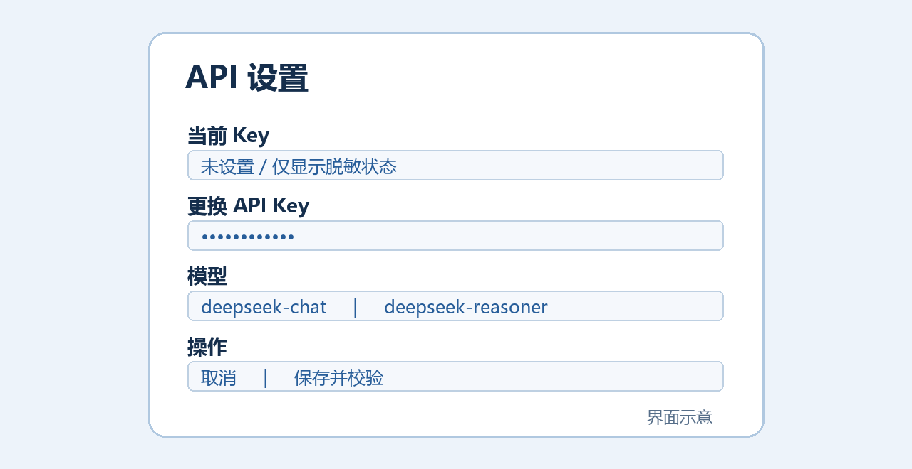
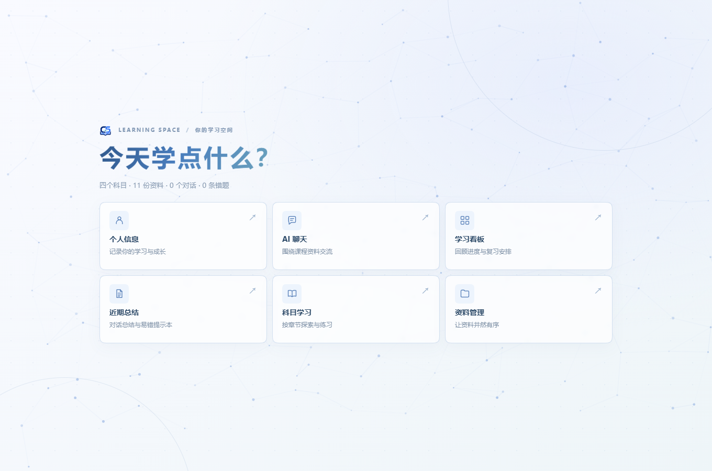
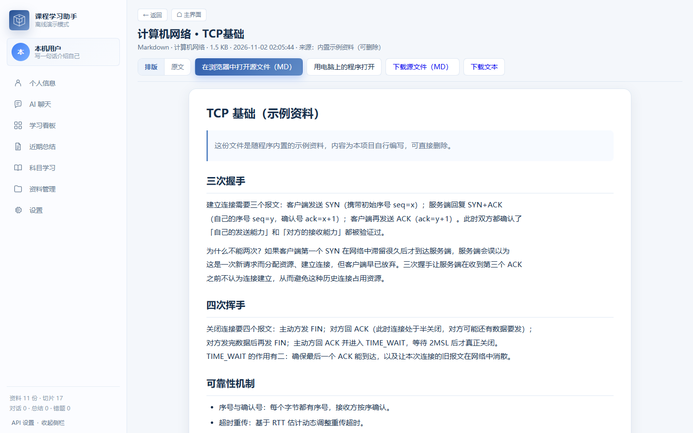
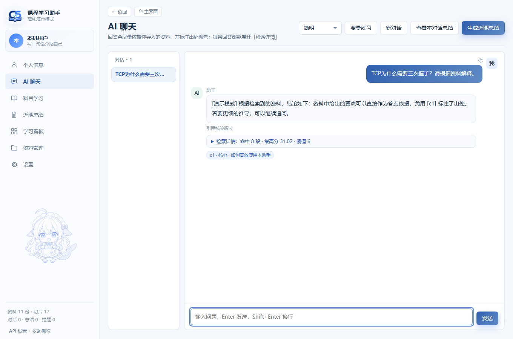

# 计算机课程学习助手用户界面设计报告

文件标识 CSLA-SD-UI · 1.2 送审 · 2026-11-23

## 版本历史

| 版本/状态 | 作者 | 参与者 | 起止日期 | 备注 |
| --- | --- | --- | --- | --- |
| 1.0 草稿 | 项目组 | 待评审确认 | 2026-11-02 | 按当前版本填写 |
|  |  |  |  |  |
| 1.1 / 送审 | 项目组 | 项目组 | 2026-11-23 | 同步应用各端的交付内容 |
| 1.2 / 送审 | 项目组 | 项目组 | 2026-11-23 | 重写导航、逐页设计、跨端差异和界面验收 |

## 0. 文档介绍

### 0.1 文档目的

本文说明课程学习助手的页面结构、导航规则、关键控件和反馈状态。设计评审可按页面编号定位界面，测试人员可根据入口、操作和可见结果编写用例。

### 0.2 文档范围

覆盖桌面浏览器、Windows 和 macOS 桌面应用，以及安卓本地应用。正文包括账号入口、模型配置、资料与阅读、聊天与学习、复习与报告、个人信息与设置。数据表结构、模型算法与安装命令分别见对应文档。

### 0.3 读者对象

面向课程评审人员、项目开发人员、测试人员及后续维护人员。首次阅读可从第 2 章的界面地图进入，再按编号跳读对应页面。

### 0.4 参考文献

[T] 课程资料，《附录 I-2 用户界面设计》模板。

[CODE] 应用交付基线，fix/android-reliability 分支，提交 cee2b4b。界面核对依据包括 index.html、app.js、各界面样式与安卓项目说明。

[PLAN] 项目组，《附录C-2 项目计划》，课程交付材料。

[LOG] 2026 年 11 月 21 日和 22 日修改日志、安卓迁移验证与桌面端验证记录。

[DESIGN] 项目计划、产品需求规格说明书、体系结构设计报告、系统测试报告与用户手册。

### 0.5 术语与缩写解释

| 缩写、术语 | 解 释 |
| --- | --- |
| UI 编号 | 页面或弹窗标识。用于串联流程、截图、功能需求和验收点。 |
| FR 编号 | 功能需求编号。来源为产品需求规格说明书。 |
| API Key | 调用 DeepSeek 的密钥。与应用登录凭据分开管理。 |
| SSE | 服务端发送事件。本应用借此逐步显示回答或生成进度。 |
| 空状态 | 无数据或无匹配内容时显示的说明及下一步入口。 |

## 1. 应当遵循的界面设计规范

### 1.1 导航与操作层级

首页负责选择任务，功能页负责显示列表，详情页负责完成具体操作。桌面侧栏始终标出当前模块，安卓通过顶部“目录”切换模块。页面标题随科目、章节或资料变化，让用户能判断自己所在的位置。

返回按访问层级处理。章节详情返回章节列表，章节列表返回科目列表，科目列表再返回首页。弹窗的关闭或取消保留原页面。安卓系统返回先处理打开的弹层，在首页再返回退出应用。

### 1.2 交互状态与数据保护

| 状态 | 界面反馈与用户下一步 |
| --- | --- |
| 初次使用或无数据 | 说明当前为空，保留导入资料、新建对话或添加科目的入口。筛选无匹配时允许改条件。 |
| 操作进行中 | 生成逐步呈现结果或显示进度。手机文件传输显示进度，并在传输阶段提供取消。 |
| 操作成功 | 刷新修改后的列表或详情，使结果可见。分节讲义完整通过校验后可重读。 |
| 操作失败或中断 | 说明失败发生在登录、模型校验、网络或文件解析哪个环节。生成中断后保留此前保存的讲义。 |
| 权限与删除 | 账号管理只向有权限的桌面用户提供。删除资料或清理数据时先明确对象和影响范围。习题删除确认遵循用户设置。 |

### 1.3 屏幕与平台规则

桌面采用侧栏和可滚动内容区，长文在阅读区内展示。安卓以单列和目录抽屉为主，原件打开、文件选择、保存和分享转由系统组件处理。各端均可在无模型密钥时阅读已保存资料和讲义。

## 2. 界面的关系图和工作流程图

### 2.1 界面地图

| 界面编号 | 页面或弹窗 | 入口 |
| --- | --- | --- |
| UI-01 | 登录与注册 | 桌面启动时选择默认用户或切换账号 |
| UI-02 | 模型设置 | 首次配置或设置 → API 设置 |
| UI-03 | 欢迎页 | 桌面进入学习空间时的引导 |
| UI-04 | 首页 | 欢迎页进入、返回主界面或手机首次启动 |
| UI-05 | AI 聊天 | 首页功能卡或侧栏 / 手机目录 |
| UI-06 | 科目与章节、章节练习 | 科目学习 → 科目 → 章节 |
| UI-07 | 资料管理 | 首页功能卡或侧栏 / 手机目录 |
| UI-08 | 资料阅读 | 资料卡、回答引用、教材页码入口 |
| UI-09 | 近期总结 | 首页功能卡或侧栏 / 手机目录 |
| UI-10 | 学习看板与复习 | 首页功能卡或侧栏 / 手机目录 |
| UI-11 | 个人信息与学习者档案 | 首页功能卡、侧栏或头像 |
| UI-12 | 账号管理 | 桌面管理员：个人信息 → 账号与数据 |
| UI-13 | 界面偏好设置 | 侧栏设置 / 手机顶部设置入口 |

### 2.2 典型用户路径

**启动与登录** 桌面打开应用后选择默认用户或切换登录。已经配置模型的用户可开始生成，未配置时可先进入资料阅读。安卓首次启动使用手机本地用户直接进入首页。

**一次课程学习** 以复习 TCP 重传为例，先在资料管理中导入课件，必要时设置主要参考和目录映射。从科目学习选择章节，生成或读取大纲与小节，再打开出处对读。随后按讲义出题，查看解析，将错题纳入复习，并在看板查看阅读、练习和复习进度。

**跨页面操作** 从 AI 聊天提问时，回答引用可进入资料阅读，返回后继续当前对话。看板检索结果也可打开相应资料。导出报告、讲义或原件时，通过对应平台的保存入口选择位置。

图 1　首页、功能页与章节页之间的导航

## 3. 主界面

#### UI-01 登录与注册

**入口与适用范围** 桌面启动后先选择已有默认用户或切换账号。安卓本地模式直接进入首页。

**页面布局** 进入方式与账号表单分开。切换账号后显示“登录”和“注册”入口，表单单独输入用户名与密码。

**操作与结果** 已有账号提交登录进入对应学习空间。首次使用可注册本地账号。退出登录后可再次选择账号。

**异常与空状态** 账号不可用或验证失败时停留在账号入口，显示登录结果。模型密钥错误在模型设置中反馈。

**返回与关联页面** 成功进入欢迎页或首页。默认用户不可用时使用切换账号入口。

图 2　UI-01 登录与注册（界面示意）

#### UI-02 模型设置

**入口与适用范围** 首次配置或从“设置”打开“API 设置”。桌面侧栏也提供 API 设置入口。

**页面布局** 弹窗包含脱敏后的当前密钥、密码型输入框、模型下拉框和“保存并校验”。

**操作与结果** 填写密钥并选择模型后提交校验。安卓可在设置中清除模型密钥。配置完成后可发起在线问答、讲义、练习或总结。

**异常与空状态** 未配置时可先阅读资料和已有内容。校验失败时在当前配置界面显示提示，用户可检查网络、密钥和余额后重试。

**返回与关联页面** 取消弹窗回到来源页。配置与切换账号分别在对应界面操作。

图 3　UI-02 模型设置（界面示意）

#### UI-03 欢迎页

**入口与适用范围** 桌面应用进入学习空间时的引导页。

**页面布局** 中心显示课程学习助手标识和进入按钮，背景使用粒子效果。

**操作与结果** 点击进入首页。欢迎动画与首页动效偏好配合，关闭动效后仍可正常进入。

**异常与空状态** 欢迎页保持主要入口可读，避免装饰遮挡操作。

**返回与关联页面** 进入 UI-04 首页。安卓首次启动可直接进入首页。

图 4　UI-03 欢迎页（演示截图）

#### UI-04 首页

**入口与适用范围** 由欢迎页进入，或从任意功能页使用主界面入口返回。

**页面布局** 中心显示标题、资料概况和六张功能卡。桌面侧栏顺序为个人信息、AI 聊天、科目学习、近期总结、学习看板、资料管理、设置。

**操作与结果** 选择功能卡或侧栏条目打开对应模块。标题和背景动效可随偏好调整。

**异常与空状态** 没有资料时仍保留各功能入口，用户可直接进入资料管理准备内容。

**返回与关联页面** 首页是功能层级起点。安卓回到首页后再按系统返回可退出。

图 5　UI-04 首页（演示截图）

## 4. 资料管理与阅读

本章对应资料整理和阅读。整理页负责把资料放入可检索的本地库，阅读页用于核对原文与出处。

#### UI-07 资料管理

**入口与适用范围** 从首页功能卡、侧栏或安卓目录进入。

**页面布局** 顶部是导入、新建文件夹和辅助整理。中部有文件夹导航、参考文献面板、搜索筛选和排序。资料列表提供勾选、批量移动和删除。

**操作与结果** 选择文件导入，将资料放到科目文件夹。可设为主要参考文献，检查和编辑目录后映射到章节。支持搜索开放教材。选中资料可批量移动或删除，手动排序适用时可拖动。

**异常与空状态** 空列表和无搜索结果提示用户调整条件。解析失败提示原因。安卓显示文件传输进度，进入解析后等待处理完成。无文字层的 PDF 需先准备可提取文本的版本。

**返回与关联页面** 打开资料卡进入 UI-08。桌面学生的核心资料写权限受限，安卓本地共享资料权限按手机模式处理。

图 6　UI-07 资料管理（演示截图）

#### UI-08 资料阅读

**入口与适用范围** 从资料卡、聊天引用、讲解出处或资料检索结果打开。

**页面布局** 顶部显示标题、资料来源和可用的排版、原文、打开或下载控件。正文按文件类型呈现。

**操作与结果** 阅读排版内容或切换原文。PDF 引用可定位到对应页，安卓 PDF 使用原生阅读器，可翻页或输入页码。通过可用控件保存原件或提取文本。

**异常与空状态** 原件不可用或无法提取正文时显示提示，用户可返回资料管理重新定位文件。引用缺少有效页码时以可查阅的原文为准。

**返回与关联页面** 完成核对后回到资料列表、当前聊天或章节。安卓恢复时会检查原资料是否仍存在。

图 7　UI-08 资料阅读（演示截图）

## 5. 学习、复习与设置

本章覆盖会话学习、章节学习、练习与复习，以及个人、账号和显示偏好。学习结果通过近期总结或看板回顾，报告和讲义通过系统保存入口留存。

### 5.1 AI 聊天与科目学习

#### UI-05 AI 聊天

**入口与适用范围** 从首页、侧栏或手机目录进入。可新建对话或打开历史会话。

**页面布局** 界面分为会话列表、问答正文和底部输入区，回答中的引用和检索详情提供来源线索。

**操作与结果** 提交问题后逐步读取回答，打开出处核对资料。可切换历史、重命名或删除对话，按需要生成对话总结。

**异常与空状态** 空会话显示提问提示，资料不足时检查科目或补充可检索资料。模型失败根据提示检查密钥、网络和额度。中文输入法选词期间避免回车误发送。

**返回与关联页面** 从引用阅读返回时继续当前会话。对话总结可到 UI-09 查看。

图 8　UI-05 AI 聊天（演示截图）

#### UI-06 科目、章节与讲义

**入口与适用范围** 首页或目录 → 科目学习 → 科目 → 章节。无 Key 时仍可手工管理科目与章节并阅读已保存内容。

**页面布局** 科目网格、章节列表与章节详情逐层展开。详情区分大纲、分节讲义、参考资料和练习，可展开或折叠小节。

**操作与结果** 先生成大纲，再生成下一节或全部未完成小节。可重新生成指定内容，完整小节保存后可重读。阅读结束可勾选已理解，引用入口用于核对教材。

**异常与空状态** 未完成输出不覆盖已有讲义。手机切到后台时生成可能中断，回到章节后可重试。已出题的小节重新生成时提示核对已有练习。

**返回与关联页面** 详情返回章节列表，再回到科目列表。完成讲解后可留在该章继续出题。

图 9　UI-06 科目、章节与讲义（演示截图）

#### UI-06 章节练习

**布局与操作** 在当前章节的练习区设定题量。题卡呈现题干、选项、所属小节和来源，支持逐题提交。

**反馈与后续** 提交后显示判分和简要解析，按需查看详细解答。答错后进入错题复习，用户可删除单题并重新生成。用已保存讲义和已有题目可继续本地复习。

图 10　UI-06 章节练习（演示截图）

### 5.2 总结、看板与错题复习

#### UI-09 近期总结与易错提示

**入口与适用范围** 从首页或导航进入“近期总结”。对话总结或章节小结生成后在此查看。

**页面布局** 列表以卡片展示总结标题和摘要，有独立入口生成易错提示本。点开卡片以详情弹窗阅读。

**操作与结果** 选择一条总结查看正文，关闭后返回列表。需查看按月学习者档案时转到个人信息。

**异常与空状态** 尚无总结时显示空列表提示。生成新总结需模型连接，已保存总结可直接阅读。

**返回与关联页面** 关闭详情回到近期总结。档案入口在 UI-11，后续复习任务在 UI-10。

图 11　UI-09 近期总结与易错提示（演示截图）

#### UI-10 学习看板与错题复习

**入口与适用范围** 从首页或导航进入，完成阅读、练习或错题复习后可查看变化。

**页面布局** 首先展示概况、学习建议和复习队列，再提供热力图、知识图谱、章节掌握度、未来复习量、错题变式和资料全文检索。

**操作与结果** 打开复习条目回顾错题，可发起变式或费曼练习。核对章节阅读、习题完成和复习状态，按需导出 Word 学习报告。

**异常与空状态** 新账号可看到零值和空队列。少量答题只更新相应记录，整章掌握还需完成阅读及错题复习等条件。导出取消后保留当前页面。

**返回与关联页面** 复习详情关闭后回到看板。资料检索或引用结果可进入 UI-08，随后返回看板。

图 12　UI-10 学习看板与错题复习（演示截图）

### 5.3 个人信息、账号与界面偏好

#### UI-11 个人信息与学习者档案

**入口与适用范围** 从首页功能卡、侧栏或头像进入。

**页面布局** 页面分为头像与显示名、基本信息、按月学习者档案和账号与数据。

**操作与结果** 保存年龄、专业、学习需求和简介等信息。上传头像后裁剪并确认，也可恢复默认头像。需要时生成本月档案或查看历史档案。

**异常与空状态** 不合法的输入或图像应显示错误。清除本人记录前确认选择和范围。普通账号看不到管理其他账号的入口。

**返回与关联页面** 取消裁剪回到个人信息。管理员可在账号与数据中打开 UI-12，其他用户可返回首页或切换模块。

图 13　UI-11 个人信息与学习者档案（演示截图）

#### UI-12 账号管理

**入口与适用范围** 桌面管理员从个人信息 → 账号与数据进入。手机本地模式不提供此入口。

**页面布局** 弹窗顶部说明禁用和密码重置的影响，列表呈现账号、角色和状态，可按用户名或昵称查找。

**操作与结果** 管理员按权限启用、禁用账号或重置密码。完成后刷新列表状态。被禁用账号无法登录，重置后使用新密码重新登录。

**异常与空状态** 普通用户无法执行账号管理。搜索无结果可更改条件，失败时在弹窗内提示。

**返回与关联页面** 关闭弹窗回到个人信息。此处管理认证账号，学习资料仍按本地账号隔离。

图 14　UI-12 账号管理（界面示意）

#### UI-13 界面偏好设置

**入口与适用范围** 从桌面侧栏“设置”或安卓顶部设置进入。

**页面布局** 按视觉与动效、阅读与学习、操作与提示、模型与偏好分为纵向分组。开关和作用说明并列。

**操作与结果** 可调整动效、鼠标互动、侧栏装饰、公式排版、正文大小、代码换行和大纲默认状态。可切换功能提示和删题前确认，也可恢复界面默认值。

**异常与空状态** 部分阅读设置在重新打开内容时生效。恢复默认值只调整界面偏好，模型连接在 UI-02 单独配置。

**返回与关联页面** 返回来源页或切换模块。API 设置弹窗关闭后回到当前设置页。

图 15　UI-13 界面偏好设置（演示截图）

## 6. 美学设计

### 6.1 色彩、排版与信息层级

浅背景、白色面板与深色正文提供稳定对比。蓝色用于主要操作，红色用于危险操作。状态同时配文字说明。阅读页优先突出标题、段落、公式和代码，避免面板层级压迫正文。

### 6.2 响应式布局与动效

桌面保留清晰侧栏与主操作区。窄屏以纵向布局、目录和可滚动列表承载同一功能。避免长文件名和代码块把页面撑出横向边界。首页粒子和标题动效可随偏好关闭；状态和主要入口保持可读。

## 7. 界面资源设计

| 资源 | 用途与维护要求 |
| --- | --- |
| 本地图标与图片 | 使用统一的线性 SVG 图标。按钮有明确文字或可访问名称。装饰元素不承载状态信息。 |
| 控件与弹窗 | 复用按钮、列表、页签、表单、确认弹窗和反馈提示。短任务在弹窗结束，长文和列表留在页面。 |
| 长文与来源 | 长讲义支持标题层级、列表、公式和代码，正文与引用入口分开。引用跳转保留返回路径。 |
| 插图与示例 | 登录、模型设置及管理员页面使用标注后的界面示意；其他图片为阶段演示截图。界面截图用于解释布局和操作位置。 |

## 8. 其他

### 8.1 关键界面验收点

| 覆盖页面 | 操作与可见结果 |
| --- | --- |
| UI-01 至 UI-04 | 切换账号、提交错误凭据、跳过模型配置、进入首页并返回。页面明确区分登录失败与密钥验证失败。 |
| UI-05 至 UI-08 | 导入资料、点击引用、返回对话、读取或中断小节并重新打开。可用出处能定位原文，原有讲义保留。 |
| UI-06、UI-09、UI-10 | 提交习题、查看解析、完成复习、查看总结并导出。阅读、练习、复习记录可在对应界面回看。 |
| UI-11 至 UI-13 | 保存头像及资料、检查桌面管理员入口、关闭弹窗、修改偏好并重开页面。操作范围与权限一致。 |
| 安卓系统交互 | 用系统选择器导入或保存，核对中文输入、PDF 跳页、系统返回及中断恢复。 |

### 8.2 证据与版本口径

据项目方确认，本轮真机验收已完成。设备、系统版本及逐项结果以原始记录为准。正式结论见系统测试报告和安卓验收清单。界面示意、桌面演示截图与真实模型专项测试分别归档。
