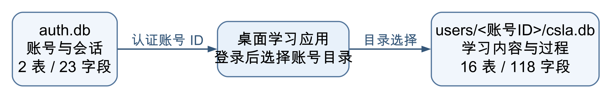
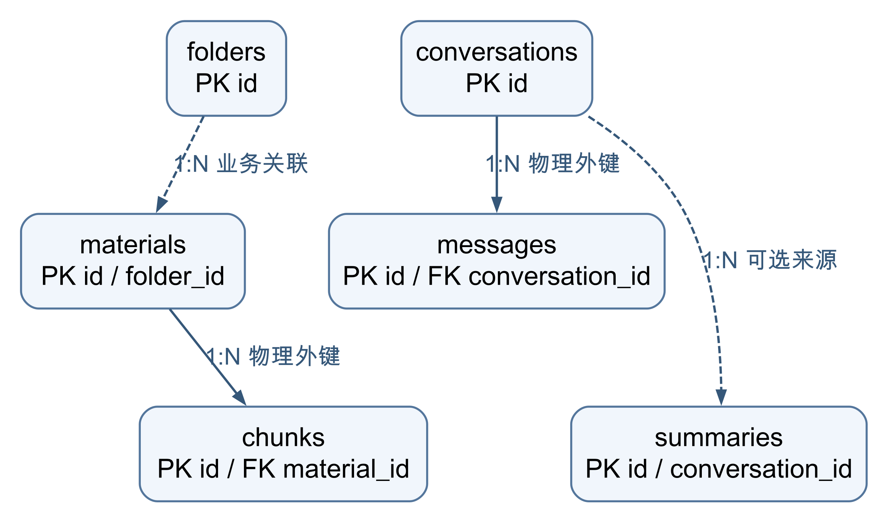
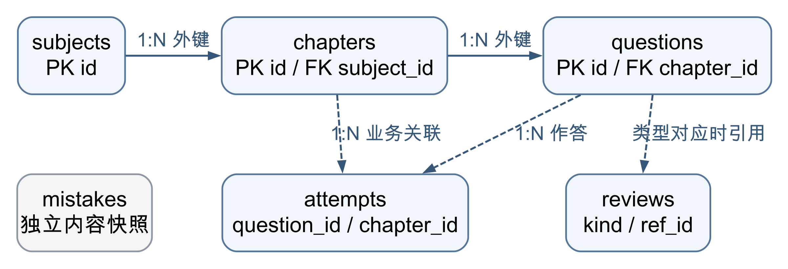
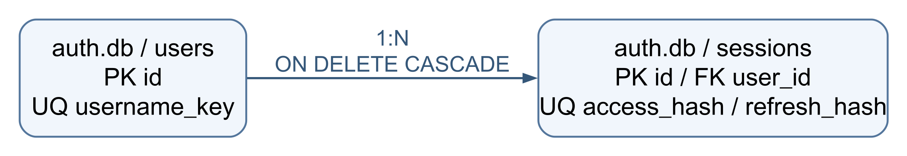

# 计算机课程学习助手（CSLA）数据库设计报告

## 文档控制

| 项目 | 内容 |
| --- | --- |
| 文件标识 | CSLA-SD-DATABASE |
| 文档版本 | 2.0 |
| 文件状态 | 正式版 |
| 编制单位 | CSLA 项目组 |
| 作者 | MinazukiHotaru |
| 完成日期 | 2026-11-22 |
| 实施基线 | fix/android-reliability / 7844441 |
| 适用范围 | macOS、Windows 桌面应用及安卓本地应用 |

## 版本历史

| 版本／状态 | 作者 | 参与者 | 起止日期 | 变更说明 |
| --- | --- | --- | --- | --- |
| 1.0／初稿 | CSLA 项目组 | CSLA 项目组 | 2026-11-21 | 建立学习库、认证库及安卓扩展的数据模型和数据字典。 |
| 1.1／修订 | CSLA 项目组 | CSLA 项目组 | 2026-11-21 | 修订任务状态、删除规则、账号权限及迁移边界。 |
| 2.0／正式版 | MinazukiHotaru | CSLA 项目组 | 2026-11-22 | 统一文档控制与排版；补充目录、第三范式分析、表／列权限和桌面部署设计。 |

## 0. 文档介绍

### 0.1 文档目的

本文规定计算机课程学习助手（CSLA）的数据库组织方式、实体关系、表结构、数据约束、安全边界和维护方法，作为系统开发、联调、维护及课程验收的共同依据。数据库设计由学习业务库 csla.db 和桌面认证库 auth.db 两部分组成：前者管理学习内容与过程，后者管理账号身份与登录会话。

### 0.2 文档范围

本报告对应源代码分支 fix/android-reliability，实施基线为提交 7844441f21584f111f4e94e16e9c2bdcecd0b46b（2026-11-22）。覆盖 macOS／Windows 桌面应用、源码调试运行方式及安卓本地运行方式的数据库结构、数据约束、访问权限、初始化、迁移和维护。

学习核心库 csla.db 包含 16 张业务表、118 个字段；桌面认证库 auth.db 包含 2 张业务表、23 个字段。桌面两库合计 18 张业务表、141 个字段。安卓使用学习核心库并增加 mobile_jobs，合计 17 张业务表、123 个字段；安卓不部署 auth.db。SQLite 内部维护表不计入业务表统计。

配套的资料原件、文本、讲义 Markdown、JSON 清单、账号会话及模型密钥文件属于持久化设计范围，须与数据库共同维护。报告区分现行实现与后续优化方案；运行验收、现存旧库升级及备份恢复测试由相应测试记录确认。

### 0.3 读者对象

读者包括项目开发人员、数据库维护人员、测试人员、课程指导教师及项目验收人员。开发人员据此实现读写和关联处理；维护人员据此定位存储目录、检查一致性并执行备份恢复；测试人员据此核对结构、权限及迁移结果。

### 0.4 参考文献

[R1] CSLA 项目组. 计算机课程学习助手源代码[CP]. CSLA 项目仓库, 2026-11-22. 分支 fix/android-reliability，提交 7844441f21584f111f4e94e16e9c2bdcecd0b46b. https://github.com/KnightofAltria/AIassistant

[R2] SQLite 开发团队. Datatypes In SQLite[EB/OL]. SQLite 项目, 发布日期未标注[2026-11-22]. https://www.sqlite.org/datatype3.html

[R3] SQLite 开发团队. SQLite Foreign Key Support[EB/OL]. SQLite 项目, 发布日期未标注[2026-11-22]. https://www.sqlite.org/foreignkeys.html

[R4] SQLite 开发团队. Quirks, Caveats, and Gotchas In SQLite[EB/OL]. SQLite 项目, 发布日期未标注[2026-11-22]. https://www.sqlite.org/quirks.html

[R5] SQLite 开发团队. SQLite Backup API[EB/OL]. SQLite 项目, 发布日期未标注[2026-11-22]. https://www.sqlite.org/backup.html

[R6] SQLite 开发团队. Write-Ahead Logging[EB/OL]. SQLite 项目, 发布日期未标注[2026-11-22]. https://www.sqlite.org/wal.html

源代码中的建表语句和补列逻辑为现行结构依据；SQLite 官方资料用于解释类型、约束、事务及备份语义。未标注发布日期的在线文献按引用日期记录。

### 0.5 术语与缩写解释

| 术语 | 含义 |
| --- | --- |
| SQLite | 以本地文件持久化的嵌入式关系数据库。 |
| PK / FK / UNIQUE | 主键 / 声明外键 / 唯一约束。 |
| 业务关联 | 字段在业务上引用另一实体，但数据库未声明外键。 |
| UUID | 应用生成的通用唯一标识，通常保存为 TEXT。 |
| BM25 | 基于文本词项统计的相关性检索方法；索引在进程内建立。 |
| RAG | 结合检索资料片段组织问答上下文的处理方式。 |
| JSON | 保存数组或对象的文本格式；当前由应用解析。 |
| PBKDF2 / SHA256 | 密码派生函数 / 摘要算法。 |
| Keystore | 安卓平台密钥管理机制。 |
| 快照 | 为兼容读取或保留历史语义而保存的内容副本。 |

## 1. 数据库环境说明

### 1.1 总体存储方案

系统采用 Python 标准库 sqlite3 直接访问 SQLite，不使用数据库服务集群或 ORM。结构化元数据与学习记录保存在数据库中；资料正文、导入原件和小节讲义保存在文件目录中。数据库记录文件路径、内容摘要和业务标识，应用层负责将这些内容组合为完整的学习资源。

| 数据库 | 主要职责 | 当前核心结构 | 使用端 |
| --- | --- | --- | --- |
| csla.db | 配置、档案、资料、对话、章节、习题、作答、错题、复习及统计。 | 16 表 / 118 字段 | 桌面端；安卓复用并扩展。 |
| auth.db | 注册、登录、密码哈希、角色、令牌轮换及设备会话。 | 2 表 / 23 字段 | 独立桌面认证服务。 |



图 1  数据库职责与账号目录边界

认证库的 users.id 用于选择桌面学习根目录下的 users/<认证账号ID>/ 目录。学习库 users.id 是该库内部独立生成的学习档案标识；两者没有跨库外键，也没有统一事务。认证成功及目录切换由应用完成；两个 users 表标识职责不同，不进行跨库同名连接。

### 1.2 运行环境、路径与访问方式

系统采用 Python sqlite3 标准库和原生 SQL 实现数据访问；桌面和安卓通过各自进程内的存储适配层访问 SQLite。物理结构由源码建表语句维护，逻辑模型以实体关系图表达。

| 运行方式 | 数据根目录 | 学习库／认证库位置 |
| --- | --- | --- |
| macOS 桌面应用 | ~/Library/Application Support/CSLA Desktop/ | learning/users/<账号ID>/csla.db；accounts/auth.db。 |
| Windows 桌面应用 | %LOCALAPPDATA%/CSLA Desktop/ | learning/users/<账号ID>/csla.db；accounts/auth.db。 |
| 源码登录模式 | app/data/，或 CSLA_DATA_DIR 指定目录 | users/<账号ID>/csla.db；独立认证服务默认 auth_server/data/auth.db。 |
| 源码单用户调试 | app/data/，或 CSLA_DATA_DIR 指定目录 | csla.db；--no-auth 模式不连接认证服务。 |
| 安卓应用 | noBackupFilesDir/learning/ | csla.db；追加 mobile_jobs，不部署认证库。 |

桌面应用的认证服务与学习服务由启动器在本机回环地址启动，端口动态分配；账号库与原源码服务的账号库独立，不自动同步。桌面学习客户端会话位于数据根目录的 learning/session.json，参考教材缓存位于 reference_library/。图 1 的 users/<账号ID>/ 为学习根目录内的相对路径。

macOS 构建使用 Python 3.12，目标为 Apple Silicon；Windows x64 包内置 CPython 3.13.17。安卓使用应用内嵌 Python 运行库。SQLite 版本、连接超时、日志模式及同步参数以各运行环境的实际值为准，部署记录须保存 sqlite3.sqlite_version 和必要的 PRAGMA 参数。

桌面默认目录由平台适配器确定；自定义数据目录以启动参数为准。源码模式可使用 CSLA_DATA_DIR 及 CSLA_REFERENCE_DIR 指定目录。数据库、密钥和账号会话必须保存在用户可写的数据目录，不能放入程序安装目录或随安装包分发。

### 1.3 连接与并发配置

学习存储层创建 sqlite3 连接，设置行对象为 sqlite3.Row，并使用 check_same_thread=False。学习库与认证库连接初始化均执行 PRAGMA foreign_keys = ON；该开关对每个连接分别生效。普通写入方法完成数据库更新后提交，批量替换切片等操作在同一方法内提交。

桌面 HTTP 层通过 CurrentStore 的 RLock 串行代理存储方法。认证服务对主要写入操作使用进程内锁。锁只约束对应进程的调用，不能代替跨进程事务或数据库文件权限。当前桌面学习服务的“当前账号”是进程级状态，适合个人桌面使用；若部署为多人同时访问的共享服务，应先改为每请求绑定账号及独立存储上下文。

当前初始化没有显式建立统一 WAL、连接池或编号迁移框架。日志模式、超时和同步参数应以实际运行环境为准；后续若调整，应记录参数、锁竞争及恢复测试结果。

### 1.4 数据库与配套文件

| 内容 | 保存位置或方式 | 数据库关系 |
| --- | --- | --- |
| 提取后的资料文本 | 资料目录中的文本文件 | materials.path 指向正文；chunks 保存其检索切片。 |
| 导入原件 | 资料目录中的原文件 | materials.original 指向原件，可用于原格式阅读。 |
| 小节讲义 | lectures/<章节ID>/section-<小节ID>.md | chapters 保存整章兼容快照；小节不另建表。 |
| 大纲和内容清单 | 同章 outline.md、manifest.json | 记录小节编号、来源、修订等内容元数据。 |
| 旧讲义修订 | 同章 history/ 等文件 | 为题目仍引用旧修订的情况保留追溯依据。 |
| 月度档案和头像 | profile/ 目录 | 与 users.profile 的画像文本并存。 |
| 桌面客户端会话 | 独立 JSON 会话文件 | 保存客户端实际令牌；auth.db 仅保存令牌哈希。 |
| 安卓模型密钥 | noBackupFilesDir/model-key.enc | Keystore 密钥加密；不放入安卓 SQLite。 |

单次 SQL 提交不会同时提交目录中的文件。讲义采用临时文件写入、刷新并替换后，再更新 SQLite 快照；多个文件与数据库之间没有共同的原子事务。因此备份、迁移和恢复应覆盖完整数据目录，并核对清单、正文及记录的一致性。

## 2. 数据库的命名规则

### 2.1 表、字段和索引命名

表名与字段名使用小写英文及下划线形式，表达业务实体或属性。现有表名大多为复数，如 materials、chapters、sessions；config、activity、usage_log 为沿用的业务名称。索引使用 idx_ 前缀加表或查询语义，SQLite 自动索引由引擎命名，应用不依赖其编号。

| 类别 | 规则与现有示例 |
| --- | --- |
| 数据库文件 | 学习库 csla.db；认证库 auth.db，职责分别管理。 |
| 业务表 | subjects、questions、attempts；关联与约束以 DDL 为准。 |
| 标识字段 | 主键通常为 id；关联字段为 subject_id、chapter_id 等。 |
| 标记和排序 | is_builtin、is_reference、revoked；排序统一沿用 ord。 |
| 时间 | created_at、updated_at、due_at；认证到期值使用 *_expires。 |
| 显式索引 | idx_chunks_material、idx_messages_conv、idx_reviews_due 等。 |
| JSON 文本 | citations、options、lecture_meta、reference_toc 等。 |

### 2.2 标识、类型与默认值

多数学习实体及认证实体以 UUID4 文本作为主键。chunks.id 与 usage_log.id 使用 INTEGER PRIMARY KEY AUTOINCREMENT；config.key 为配置自然键，activity.day 为日期自然键。安卓 mobile_jobs.chapter_id 复用章节标识作为自然主键，不额外生成任务 ID。

SQLite 类型按实际 DDL 中的 TEXT 或 INTEGER 记录。TEXT 没有在本结构中声明固定长度；INTEGER 是整数存储类型，业务计数和 0/1 标志仍需应用校验。JSON 列以 TEXT 保存，未声明 json_valid CHECK；角色、审核状态与布尔标志也没有枚举 CHECK。本文中的用途和应用取值不是额外数据库约束。

默认值仅在插入时省略该列等适用情形下生效，不代表显式写入 NULL 会自动转成空字符串或零。许多可选关联使用空字符串表示未关联；读取、校验及维护时应同时考虑空字符串与可空列中可能出现的 NULL。

### 2.3 时间及空值规则

学习库多数时间字段由应用按本地时间格式 YYYY-MM-DD HH:MM:SS 写入；activity.day 使用 YYYY-MM-DD。认证库的 created_at、login_at 等也是本地时间文本，access_expires 与 refresh_expires 则为 Unix 秒级时间戳。时间文本在格式一致时支持字典序比较，但跨设备、跨时区导入需明确转换规则。

第 4 章的“非空声明”严格区分 NOT NULL 和未显式声明。普通 SQLite 表中的 TEXT PRIMARY KEY 没有普遍禁止 NULL 的隐含效果；应用生成非空 ID，不等于 DDL 已声明 NOT NULL。INTEGER PRIMARY KEY 具有 rowid 标识语义，插入 NULL 时会生成整数标识，不应解释为持久化一个空主键。[R4]

后续新增主键非空、状态校验或统一时间标准时，须通过版本迁移实施；现行约束以本报告的数据字典为准。

## 3. 逻辑设计

### 3.1 实体划分与主要业务

| 业务域 | 实体 | 设计作用 |
| --- | --- | --- |
| 学习环境 | config、学习 users | 配置与个人学习档案，不保存认证身份凭据。 |
| 资料检索 | folders、materials、chunks | 分别管理分类、来源元数据和检索切片。 |
| 对话总结 | conversations、messages、summaries | 区分会话容器、消息明细及独立总结内容。 |
| 课程练习 | subjects、chapters、questions、attempts | 组织课程层级，保存题目与多次作答。 |
| 错题复习 | mistakes、reviews | 保存内容快照与复习阶段，支持个人补充及调度。 |
| 使用统计 | usage_log、activity | 调用明细与每日活动聚合分别保存。 |
| 账号认证 | 认证 users、sessions | 账号与多设备登录会话分离。 |

关系图用实线表示当前 DDL 已声明的外键，用虚线表示应用维护的业务关联。箭头从父实体指向子实体，1:N 表示一条父记录可对应多条子记录；是否允许未关联由字段和具体业务决定。配置、学习档案和统计表为独立实体，表汇总中列出完整范围。

### 3.2 资料与对话模型



图 2  资料组织与对话明细关系

一份资料可分成多条文本切片，删除资料时切片级联删除。文件夹到资料是业务上的一对多；folder_id 未声明外键，移动或删除文件夹由应用处理。一条对话包含多条消息，消息由 conversation_id 外键约束；总结可带来源对话 ID，但也可独立存在。

### 3.3 课程、作答与复习模型



图 3  科目、章节、题目、作答及复习关系

科目—章节—题目构成两层物理一对多关系。作答记录保留逐次答案，不把最近一次答案覆盖在题目表中。章节与作答、题目与作答属于业务一对多关系。复习卡片的 ref_id 随 kind 解释，在答错流程中可引用题目；错题表保存独立内容快照，不能默认认为每条 reviews 记录都引用 mistakes。

章节可选关联一份参考资料并记录参考范围，关联由 chapters.reference_material_id 与 reference_section 表达。小节是 manifest.json 中的内容单元，未设置 sections 表。阅读勾选保存在 config；学习进度及掌握度结合有效阅读标记、题目作答和复习状态计算，不另建 progress 表。

### 3.4 认证模型与两库边界



图 4  独立认证库的账号与会话关系

每个认证账号可有多个会话。sessions.user_id 为认证库 users.id 的外键，删除账号时会话级联删除。账号表负责用户名唯一性、密码哈希、状态和角色；会话表负责两个令牌哈希、到期、撤销和设备信息。

认证账号不会通过外键拥有学习表中的全部记录。桌面登录模式通过账号目录隔离整个学习库，学习记录一般没有认证 user_id 列。管理员接口管理账号本身，没有提供读取其他账号聊天、资料或讲义的能力。

### 3.5 第三范式分析与受控冗余

规范化设计以消除重复实体、部分函数依赖和传递函数依赖为目标。现行核心模型按资料、文本切片、对话、消息、科目、章节、题目和作答分别建表，各表通过单列主键标识记录。业务属性由本实体标识确定；用户名归一键及科目 slug 另有唯一约束，减少重复业务实体。

| 分析项 | 设计处理 | 结论与约束 |
| --- | --- | --- |
| 第一范式 | 关系层以单列表示单一属性；选项、引用和元数据按完整 JSON 文本存取。 | JSON 在当前关系层作为序列化值使用，其内部集合不具有独立关系约束；按子项查询或约束时须拆表。 |
| 第二范式 | 实体表采用单列主键，实体属性依赖该主键。 | 不存在对复合主键真子集的部分依赖。 |
| 第三范式 | 主实体与明细实体分离，资料正文、消息、章节题目和会话明细独立维护。 | 按实体边界减少非键属性之间的传递依赖；快照及统计冗余按下表单独管理。 |

现行结构包含用于历史显示、兼容读取和章节统计的受控冗余，不将全部物理字段认定为严格第三范式。冗余字段必须有明确来源、更新职责和一致性检查。

| 冗余对象 | 保留理由 | 维护规则 |
| --- | --- | --- |
| mistakes、reviews 中的科目、章节、题干及答案 | 保存错题与复习内容的历史语义，源内容修订或删除后仍可显示。 | 按快照管理，不随源内容修改自动覆盖；删除策略须保留历史显示或明确彻底清理。 |
| attempts.chapter_id | 可由 question_id 推导，另存以支持按章节统计。 | 作答写入时取题目所属章节；维护时核对与 questions.chapter_id 的一致性。 |
| chapters.lecture、lecture_meta | 保留讲义兼容副本。 | manifest.json 存在时以小节文件和清单为读取依据；不得用旧快照覆盖当前文件。 |
| activity.day 对应事件总数 | 按日聚合，减少活动图读取成本。 | 由业务事件更新；它是累计事件计数，不等同于独立时长或完整审计明细。 |

引用数组、题目选项、书目信息及讲义元数据作为 JSON TEXT 存储，当前由应用整体解析和更新。若需要对单项内容实施唯一性、外键或频繁筛选，须评估独立关系表或经过验证的 JSON 索引方案。

## 4. 物理设计

### 4.0 表汇总与数据字典口径

| 库 | 表名 | 字段数 | 主键 | 功能说明 |
| --- | --- | --- | --- | --- |
| csla.db | config | 2 | key | 保存应用配置、缓存修订号及小节阅读勾选。 |
| csla.db | users | 9 | id | 保存当前学习数据库内的学习者档案。 |
| csla.db | folders | 6 | id | 组织资料文件夹及显示顺序。 |
| csla.db | materials | 16 | id | 保存资料来源、文本和原件路径、审核状态与参考教材信息。 |
| csla.db | chunks | 4 | id | 保存资料文本切片，为本地检索提供输入。 |
| csla.db | conversations | 5 | id | 保存学习对话的基本信息。 |
| csla.db | messages | 6 | id | 保存对话消息正文及引用。 |
| csla.db | summaries | 6 | id | 保存近期或阶段学习总结。 |
| csla.db | subjects | 5 | id | 保存科目目录及内置科目标记。 |
| csla.db | chapters | 10 | id | 保存科目章节、大纲、讲义快照及教材关联。 |
| csla.db | questions | 9 | id | 保存章节题目、答案、解析与讲义出处。 |
| csla.db | attempts | 6 | id | 逐次记录学习者作答及判定结果。 |
| csla.db | mistakes | 8 | id | 保存错题内容和个人笔记快照。 |
| csla.db | reviews | 14 | id | 保存复习卡片及间隔复习调度状态。 |
| csla.db | usage_log | 10 | id | 保存调用数量、估算用量与等待时长。 |
| csla.db | activity | 2 | day | 累计按日学习事件，用于活动图及连续学习统计。 |
| auth.db | users | 10 | id | 保存账号身份、密码哈希、账号状态和角色。 |
| auth.db | sessions | 13 | id | 保存令牌哈希、过期时间、撤销状态与设备登录信息。 |

下列字典列出所有 141 个核心字段，默认值保留 SQL 字面量：无表示没有声明 DEFAULT，'' 表示空字符串，'[]' 与 '{}' 表示 JSON 文本默认值。PK 为主键，FK 为声明外键，UQ 为 UNIQUE。除明示约束外，不推断存在外键、长度限制、枚举或 CHECK。

“未显式”表示 DDL 未写 NOT NULL；整数主键仍按第 2.3 节的 rowid 语义处理。应用始终生成合法标识并校验业务内容。数据库初始化以源代码的 SCHEMA 与补列逻辑为准；数据字典用于结构核对，不替代运行库备份或增量迁移。

### 4.0.1 类型精度、范围与应用校验

| 数据类型／用途 | 数据库存储范围 | 应用规则 |
| --- | --- | --- |
| INTEGER | 有符号 64 位整数；当前表未声明精度或范围 CHECK。 | 计数、排序和时间戳按业务类型校验；布尔标志使用 0／1。 |
| TEXT | 未声明固定字符长度；实际上限受 SQLite 编译及运行配置限制。 | 标识采用非空 UUID 文本；用户名、密码和设备名按对应接口校验。 |
| JSON TEXT | 按文本保存；未声明 json_valid CHECK。 | 校验预期数组／对象类型，处理空值、旧记录和解析失败。 |
| 时间文本 | 未声明专用时间类型。 | 统一格式 YYYY-MM-DD HH:MM:SS；跨时区导入须转换。 |
| Unix 时间戳 | INTEGER 秒级时间值。 | 认证令牌到期值由认证服务生成和比较。 |

SQLite 使用类型亲和性，现行表不是 STRICT 表；DDL 类型声明不等于强制拒绝所有其他存储类型。[R2] 业务范围校验与数据库约束须分别识别，不将接口限制记为未实施的 CHECK。

### 4.1 config 表

所属数据库：csla.db。用途：保存应用配置、缓存修订号及小节阅读勾选。

| 字段名 | 类型 | 非空声明 | 默认值 | 约束 | 字段说明 |
| --- | --- | --- | --- | --- | --- |
| key | TEXT | 未显式 | 无 | PK | 配置名称；阅读勾选采用 reading:<章节ID> 等业务键。 |
| value | TEXT | NOT NULL | 无 | — | 配置值；按键保存字符串、计数或 JSON 文本。 |

索引与唯一性：主键标识；无其他显式索引或唯一约束。

补充说明：配置键的结构由应用定义。reading:<章节ID> 的值是小节 ID 到内容 SHA256 哈希的映射；内容变化后旧勾选不再计为已读。桌面 api_key 可经通用配置路径持久化，安卓另用密钥保险库。

### 4.2 users 表

所属数据库：csla.db。用途：保存当前学习数据库内的学习者档案。

| 字段名 | 类型 | 非空声明 | 默认值 | 约束 | 字段说明 |
| --- | --- | --- | --- | --- | --- |
| id | TEXT | 未显式 | 无 | PK | 学习档案标识，由应用独立生成 UUID。 |
| name | TEXT | NOT NULL | 无 | — | 学习者显示名称，初始化可使用“本机用户”。 |
| profile | TEXT | 未显式 | '' | — | 学习画像文本；与 profile 目录中的月度档案分别存储。 |
| created_at | TEXT | NOT NULL | 无 | — | 档案创建时间。 |
| age | TEXT | 未显式 | '' | — | 年龄信息；当前按文本保存。 |
| gender | TEXT | 未显式 | '' | — | 性别信息；当前按文本保存。 |
| major | TEXT | 未显式 | '' | — | 专业或学习方向。 |
| needs | TEXT | 未显式 | '' | — | 学习需求与目标文本。 |
| bio | TEXT | 未显式 | '' | — | 个人简介文本。 |

索引与唯一性：主键标识；无其他显式索引或唯一约束。

补充说明：本表不含用户名、密码哈希或角色。ensure_user() 在本库中独立创建学习档案，不能把本表 id 当作认证库账号 id。

### 4.3 folders 表

所属数据库：csla.db。用途：组织资料文件夹及显示顺序。

| 字段名 | 类型 | 非空声明 | 默认值 | 约束 | 字段说明 |
| --- | --- | --- | --- | --- | --- |
| id | TEXT | 未显式 | 无 | PK | 文件夹 UUID 标识。 |
| name | TEXT | NOT NULL | 无 | — | 文件夹显示名称。 |
| created_at | TEXT | NOT NULL | 无 | — | 文件夹创建时间。 |
| slug | TEXT | 未显式 | '' | — | 文件夹业务短标识；当前没有唯一约束。 |
| is_shared | INTEGER | 未显式 | 0 | — | 共享分类标志；应用以 0/1 表示，非数据库权限。 |
| ord | INTEGER | 未显式 | 0 | — | 显示排序序号。 |

索引与唯一性：主键标识；无其他显式索引或唯一约束。

补充说明：slug、name 均未声明 UNIQUE。is_shared 表示业务分类，不能凭该字段判断其他账号是否获得了文件访问权限。

### 4.4 materials 表

所属数据库：csla.db。用途：保存资料来源、文本和原件路径、审核状态与参考教材信息。

| 字段名 | 类型 | 非空声明 | 默认值 | 约束 | 字段说明 |
| --- | --- | --- | --- | --- | --- |
| id | TEXT | 未显式 | 无 | PK | 资料 UUID 标识。 |
| title | TEXT | NOT NULL | 无 | — | 资料标题。 |
| subject | TEXT | 未显式 | '' | — | 资料的科目分类文本，不是 subjects 外键。 |
| folder_id | TEXT | 未显式 | '' | — | 所属文件夹 ID；空字符串表示未指定。 |
| source_url | TEXT | 未显式 | '' | — | 资料来源网页地址；本地导入可为空。 |
| path | TEXT | 未显式 | '' | — | 提取后文本文件的本地路径。 |
| bytes | INTEGER | 未显式 | 0 | — | 文本文件的字节数，不是全部原件的总大小。 |
| created_at | TEXT | NOT NULL | 无 | — | 资料导入或记录创建时间。 |
| hash | TEXT | 未显式 | '' | — | 文本内容 SHA256 摘要的前 16 个十六进制字符。 |
| status | TEXT | 未显式 | 'approved' | — | 资料审核状态；应用控制取值，默认 approved。 |
| fetched_at | TEXT | 未显式 | '' | — | 网络资料获取时间；本地资料可为空。 |
| original | TEXT | 未显式 | '' | — | 导入原件的本地路径；没有原件时为空。 |
| is_reference | INTEGER | 未显式 | 0 | — | 是否作为参考教材；应用以 0/1 表示。 |
| reference_toc | TEXT | 未显式 | '[]' | — | 参考教材目录，JSON 数组文本。 |
| bibliography | TEXT | 未显式 | '{}' | — | 书目信息，JSON 对象文本。 |
| ord | INTEGER | 未显式 | 0 | — | 资料显示顺序；较小的序号排在前面。 |

索引与唯一性：主键标识；无其他显式索引或唯一约束。

补充说明：folder_id 业务关联 folders.id。hash 用于资料内容识别及缓存更新，没有唯一约束，且截断摘要不能当作严格的全文件唯一凭证。参考教材查询还要求审核通过。

### 4.5 chunks 表

所属数据库：csla.db。用途：保存资料文本切片，为本地检索提供输入。

| 字段名 | 类型 | 非空声明 | 默认值 | 约束 | 字段说明 |
| --- | --- | --- | --- | --- | --- |
| id | INTEGER | 未显式 | 无 | PK / 自增 | 文本切片自增整数标识。 |
| material_id | TEXT | NOT NULL | 无 | FK | 所属资料 ID。 |
| ord | INTEGER | NOT NULL | 无 | — | 切片在该资料中的顺序。 |
| text | TEXT | NOT NULL | 无 | — | 切片正文，用于分词、BM25 检索及引用。 |

外键：material_id → materials.id；ON DELETE CASCADE；ON UPDATE NO ACTION。

索引与唯一性：idx_chunks_material(material_id)，非唯一显式索引

补充说明：material_id 为级联删除外键。replace_chunks() 重新写入某份资料的切片；material_id 与 ord 没有联合唯一约束。BM25 索引在进程中建立，不在此表保存向量。

### 4.6 conversations 表

所属数据库：csla.db。用途：保存学习对话的基本信息。

| 字段名 | 类型 | 非空声明 | 默认值 | 约束 | 字段说明 |
| --- | --- | --- | --- | --- | --- |
| id | TEXT | 未显式 | 无 | PK | 对话 UUID 标识。 |
| kind | TEXT | NOT NULL | 'chat' | — | 对话类型；默认 chat，取值由应用控制。 |
| title | TEXT | NOT NULL | 无 | — | 对话标题。 |
| created_at | TEXT | NOT NULL | 无 | — | 对话创建时间。 |
| updated_at | TEXT | NOT NULL | 无 | — | 对话最后更新时间。 |

索引与唯一性：主键标识；无其他显式索引或唯一约束。

补充说明：删除对话会级联删除消息。summaries.conversation_id 未声明外键，相关总结的处理需要由业务明确。

### 4.7 messages 表

所属数据库：csla.db。用途：保存对话消息正文及引用。

| 字段名 | 类型 | 非空声明 | 默认值 | 约束 | 字段说明 |
| --- | --- | --- | --- | --- | --- |
| id | TEXT | 未显式 | 无 | PK | 消息 UUID 标识。 |
| conversation_id | TEXT | NOT NULL | 无 | FK | 所属对话 ID。 |
| role | TEXT | NOT NULL | 无 | — | 消息角色，如 user、assistant；由应用控制。 |
| content | TEXT | NOT NULL | 无 | — | 消息正文。 |
| citations | TEXT | 未显式 | '[]' | — | 引用信息，JSON 数组文本。 |
| created_at | TEXT | NOT NULL | 无 | — | 消息写入时间。 |

外键：conversation_id → conversations.id；ON DELETE CASCADE；ON UPDATE NO ACTION。

索引与唯一性：idx_messages_conv(conversation_id)，非唯一显式索引

补充说明：消息读取按对话过滤，并按 created_at、rowid 排序。同一时间值下由 rowid 补充顺序。role 与 citations 的合法性由应用处理。

### 4.8 summaries 表

所属数据库：csla.db。用途：保存近期或阶段学习总结。

| 字段名 | 类型 | 非空声明 | 默认值 | 约束 | 字段说明 |
| --- | --- | --- | --- | --- | --- |
| id | TEXT | 未显式 | 无 | PK | 总结 UUID 标识。 |
| kind | TEXT | NOT NULL | 无 | — | 总结类别，如近期或阶段总结，由应用指定。 |
| title | TEXT | NOT NULL | 无 | — | 总结标题。 |
| content | TEXT | NOT NULL | 无 | — | 总结正文。 |
| conversation_id | TEXT | 未显式 | '' | — | 关联对话 ID；独立总结可为空字符串。 |
| created_at | TEXT | NOT NULL | 无 | — | 总结创建时间。 |

索引与唯一性：主键标识；无其他显式索引或唯一约束。

补充说明：conversation_id 是可选的业务来源标识；本表允许独立总结。删除来源对话不会由数据库自动删除总结。

### 4.9 subjects 表

所属数据库：csla.db。用途：保存科目目录及内置科目标记。

| 字段名 | 类型 | 非空声明 | 默认值 | 约束 | 字段说明 |
| --- | --- | --- | --- | --- | --- |
| id | TEXT | 未显式 | 无 | PK | 科目 UUID 标识。 |
| slug | TEXT | NOT NULL | 无 | UQ | 科目业务短标识；用于路由及科目查找。 |
| name | TEXT | NOT NULL | 无 | — | 科目显示名称。 |
| ord | INTEGER | NOT NULL | 0 | — | 科目排序序号。 |
| is_builtin | INTEGER | 未显式 | 0 | — | 内置科目标志；应用对内置科目施加删除限制。 |

索引与唯一性：UNIQUE(slug)，由 SQLite 建立自动索引

补充说明：slug 是本表除主键外的唯一键。删除科目时，章节及题目受级联关系约束；应用另限制删除内置科目。

### 4.10 chapters 表

所属数据库：csla.db。用途：保存科目章节、大纲、讲义快照及教材关联。

| 字段名 | 类型 | 非空声明 | 默认值 | 约束 | 字段说明 |
| --- | --- | --- | --- | --- | --- |
| id | TEXT | 未显式 | 无 | PK | 章节 UUID 标识。 |
| subject_id | TEXT | NOT NULL | 无 | FK | 所属科目 ID。 |
| title | TEXT | NOT NULL | 无 | — | 章节标题。 |
| ord | INTEGER | NOT NULL | 0 | — | 在所属科目中的显示顺序。 |
| outline | TEXT | 未显式 | '' | — | 章节大纲文本。 |
| is_builtin | INTEGER | 未显式 | 0 | — | 内置章节标志；应用以 0/1 表示。 |
| lecture | TEXT | 未显式 | '' | — | 整章讲义的兼容文本快照。 |
| lecture_meta | TEXT | 未显式 | '{}' | — | 小节、来源及修订信息的 JSON 对象快照。 |
| reference_material_id | TEXT | 未显式 | '' | — | 参考教材资料 ID；未关联时为空字符串。 |
| reference_section | TEXT | 未显式 | '' | — | 参考教材中的章节或范围描述。 |

外键：subject_id → subjects.id；ON DELETE CASCADE；ON UPDATE NO ACTION。

索引与唯一性：主键标识；无其他显式索引或唯一约束。

补充说明：subject_id 为物理外键。reference_material_id 为可选教材业务关联。lectures/<章节ID>/ 中的 Markdown 与 manifest.json 是小节内容读取的重要依据，lecture 与 lecture_meta 用于兼容快照。

### 4.11 questions 表

所属数据库：csla.db。用途：保存章节题目、答案、解析与讲义出处。

| 字段名 | 类型 | 非空声明 | 默认值 | 约束 | 字段说明 |
| --- | --- | --- | --- | --- | --- |
| id | TEXT | 未显式 | 无 | PK | 题目 UUID 标识。 |
| chapter_id | TEXT | NOT NULL | 无 | FK | 所属章节 ID。 |
| stem | TEXT | NOT NULL | 无 | — | 题干文本。 |
| options | TEXT | 未显式 | '[]' | — | 选项列表，JSON 数组文本。 |
| answer | TEXT | 未显式 | '' | — | 参考答案。 |
| explanation | TEXT | 未显式 | '' | — | 基础解析文本。 |
| created_at | TEXT | NOT NULL | 无 | — | 题目创建时间。 |
| source_meta | TEXT | 未显式 | '' | — | 题目出处的 JSON 文本；未设置时为空字符串。 |
| detailed_explanation | TEXT | 未显式 | '' | — | 详细解析文本。 |

外键：chapter_id → chapters.id；ON DELETE CASCADE；ON UPDATE NO ACTION。

索引与唯一性：主键标识；无其他显式索引或唯一约束。

补充说明：chapter_id 为级联删除外键。source_meta 可携带小节、修订、引用等来源信息；详细内容由应用组织，不另建来源实体表。

### 4.12 attempts 表

所属数据库：csla.db。用途：逐次记录学习者作答及判定结果。

| 字段名 | 类型 | 非空声明 | 默认值 | 约束 | 字段说明 |
| --- | --- | --- | --- | --- | --- |
| id | TEXT | 未显式 | 无 | PK | 单次作答 UUID 标识。 |
| question_id | TEXT | NOT NULL | 无 | — | 作答题目 ID；业务关联，不是声明外键。 |
| chapter_id | TEXT | NOT NULL | 无 | — | 所属章节 ID；用于章节统计。 |
| answer | TEXT | 未显式 | '' | — | 本次提交的答案。 |
| correct | INTEGER | 未显式 | 0 | — | 判定结果；应用以 1 表示正确、0 表示错误。 |
| created_at | TEXT | NOT NULL | 无 | — | 本次作答时间。 |

索引与唯一性：主键标识；无其他显式索引或唯一约束。

补充说明：同一题目可有多次作答，因此没有 question_id 唯一约束。question_id 与 chapter_id 没有声明外键；当前删除题目或章节不会自动清除全部作答，需在维护时检查残留关联。

### 4.13 mistakes 表

所属数据库：csla.db。用途：保存错题内容和个人笔记快照。

| 字段名 | 类型 | 非空声明 | 默认值 | 约束 | 字段说明 |
| --- | --- | --- | --- | --- | --- |
| id | TEXT | 未显式 | 无 | PK | 错题 UUID 标识。 |
| subject | TEXT | 未显式 | '' | — | 科目显示文本，不是科目 ID。 |
| chapter | TEXT | 未显式 | '' | — | 章节显示文本，不是章节 ID。 |
| stem | TEXT | NOT NULL | 无 | — | 错题题干快照。 |
| my_answer | TEXT | 未显式 | '' | — | 学习者的错误答案。 |
| right_answer | TEXT | 未显式 | '' | — | 正确答案。 |
| note | TEXT | 未显式 | '' | — | 错题笔记或补充说明。 |
| created_at | TEXT | NOT NULL | 无 | — | 错题记录创建时间。 |

索引与唯一性：主键标识；无其他显式索引或唯一约束。

补充说明：科目、章节、题干和答案按快照保存，能够独立显示。它不是 attempts 的外键子表；源题修订不会自动覆盖错题快照。

### 4.14 reviews 表

所属数据库：csla.db。用途：保存复习卡片及间隔复习调度状态。

| 字段名 | 类型 | 非空声明 | 默认值 | 约束 | 字段说明 |
| --- | --- | --- | --- | --- | --- |
| id | TEXT | 未显式 | 无 | PK | 复习卡片 UUID 标识。 |
| kind | TEXT | NOT NULL | 'mistake' | — | 卡片类型；默认 mistake，取值由应用控制。 |
| ref_id | TEXT | 未显式 | '' | — | 来源标识；随类型解释，答错流程可保存题目 ID。 |
| subject | TEXT | 未显式 | '' | — | 科目显示文本。 |
| chapter | TEXT | 未显式 | '' | — | 章节显示文本。 |
| stem | TEXT | NOT NULL | 无 | — | 复习内容或题干快照。 |
| answer | TEXT | 未显式 | '' | — | 参考答案快照。 |
| note | TEXT | 未显式 | '' | — | 复习提示与笔记。 |
| stage | INTEGER | 未显式 | 0 | — | 间隔复习阶段；由应用的调度算法调整。 |
| due_at | TEXT | NOT NULL | 无 | — | 下次复习到期时间。 |
| last_at | TEXT | 未显式 | '' | — | 最近一次复习时间；未复习时为空字符串。 |
| reps | INTEGER | 未显式 | 0 | — | 已完成复习次数。 |
| lapses | INTEGER | 未显式 | 0 | — | 遗忘或失败累计次数。 |
| created_at | TEXT | NOT NULL | 无 | — | 复习卡片创建时间。 |

索引与唯一性：idx_reviews_due(due_at)，非唯一显式索引

补充说明：ref_id 是随 kind 解释的来源标识，不能统一声明指向某一张表。答错流程以题目 ID 关联复习卡片；手工卡片可没有来源。add_review() 先按传入的完整 stem 查找，存在则返回原记录；新题干只保存前 500 个字符。因此长题干的去重可能失效，数据库也未声明 UNIQUE(stem)。stage、reps、lapses 的范围由应用控制，没有 CHECK。

### 4.15 usage_log 表

所属数据库：csla.db。用途：保存调用数量、估算用量与等待时长。

| 字段名 | 类型 | 非空声明 | 默认值 | 约束 | 字段说明 |
| --- | --- | --- | --- | --- | --- |
| id | INTEGER | 未显式 | 无 | PK / 自增 | 调用记录自增整数标识。 |
| kind | TEXT | NOT NULL | 无 | — | 调用业务类别。 |
| model | TEXT | 未显式 | '' | — | 模型名称。 |
| prompt_chars | INTEGER | 未显式 | 0 | — | 输入文本字符数。 |
| completion_chars | INTEGER | 未显式 | 0 | — | 输出文本字符数。 |
| tokens_est | INTEGER | 未显式 | 0 | — | 估算 token 数量，不保证等于供应商账单计量。 |
| first_ms | INTEGER | 未显式 | 0 | — | 首次响应等待时长，单位毫秒。 |
| total_ms | INTEGER | 未显式 | 0 | — | 本次调用总时长，单位毫秒。 |
| ok | INTEGER | 未显式 | 1 | — | 调用成功标志；应用以 1/0 表示。 |
| created_at | TEXT | NOT NULL | 无 | — | 调用记录创建时间。 |

索引与唯一性：idx_usage_time(created_at)，非唯一显式索引

补充说明：计量按业务调用记录，不是付费订单表。当前保存估算用量与等待时长，不保存供应商结算明细。

### 4.16 activity 表

所属数据库：csla.db。用途：累计按日学习事件，用于活动图及连续学习统计。

| 字段名 | 类型 | 非空声明 | 默认值 | 约束 | 字段说明 |
| --- | --- | --- | --- | --- | --- |
| day | TEXT | 未显式 | 无 | PK | 活动日期，自然主键；格式 YYYY-MM-DD。 |
| events | INTEGER | 未显式 | 0 | — | 当天累计学习事件数，不是学习时长。 |

索引与唯一性：主键标识；无其他显式索引或唯一约束。

补充说明：day 是自然主键。应用通过累加 events 记录每日活动，连续学习天数由日期记录计算。

### 4.17 users（认证账号） 表

所属数据库：auth.db。用途：保存账号身份、密码哈希、账号状态和角色。

| 字段名 | 类型 | 非空声明 | 默认值 | 约束 | 字段说明 |
| --- | --- | --- | --- | --- | --- |
| id | TEXT | 未显式 | 无 | PK | 认证账号 UUID 标识；用于桌面学习目录定位。 |
| username | TEXT | NOT NULL | 无 | — | 注册用户名，保留输入大小写。 |
| username_key | TEXT | NOT NULL | 无 | UQ | 小写归一后的用户名；唯一查找键。 |
| nickname | TEXT | 未显式 | '' | — | 账号昵称；应用校验最多 20 个字。 |
| password_hash | TEXT | NOT NULL | 无 | — | 含算法、迭代次数、随机盐和摘要的密码哈希文本。 |
| status | TEXT | NOT NULL | 'active' | — | 账号状态；active 可用，disabled 禁用，由应用管理。 |
| role | TEXT | NOT NULL | 'student' | — | 账号角色；student 或 admin，由应用校验。 |
| created_at | TEXT | NOT NULL | 无 | — | 账号创建时间。 |
| updated_at | TEXT | NOT NULL | 无 | — | 账号资料、密码或管理属性更新时间。 |
| last_login_at | TEXT | 未显式 | '' | — | 最近一次成功登录时间；从未登录可为空字符串。 |

索引与唯一性：UNIQUE(username_key)，由 SQLite 建立自动索引

补充说明：用户名按小写归一键唯一化。注册默认为 student；角色授予由认证服务本机管理命令执行。账号状态与角色没有数据库 CHECK，约束由服务校验。

### 4.18 sessions（认证会话） 表

所属数据库：auth.db。用途：保存令牌哈希、过期时间、撤销状态与设备登录信息。

| 字段名 | 类型 | 非空声明 | 默认值 | 约束 | 字段说明 |
| --- | --- | --- | --- | --- | --- |
| id | TEXT | 未显式 | 无 | PK | 会话 UUID 标识。 |
| user_id | TEXT | NOT NULL | 无 | FK | 所属认证账号 ID。 |
| access_hash | TEXT | NOT NULL | 无 | UQ | 访问令牌 SHA256 哈希；不保存访问令牌原文。 |
| refresh_hash | TEXT | NOT NULL | 无 | UQ | 刷新令牌 SHA256 哈希；不保存刷新令牌原文。 |
| access_expires | INTEGER | NOT NULL | 无 | — | 访问令牌到期时刻，Unix 秒级时间戳。 |
| refresh_expires | INTEGER | NOT NULL | 无 | — | 刷新令牌到期时刻，Unix 秒级时间戳。 |
| created_at | TEXT | NOT NULL | 无 | — | 当前会话记录签发时间。 |
| revoked | INTEGER | NOT NULL | 0 | — | 撤销标志；应用以 0 表示有效、1 表示撤销。 |
| user_agent | TEXT | 未显式 | '' | — | 客户端 User-Agent，应用截取前 200 个字符。 |
| ip | TEXT | 未显式 | '' | — | 登录请求来源 IP，应用截取前 64 个字符。 |
| device | TEXT | 未显式 | '' | — | 客户端自报设备名，应用截取前 60 个字符。 |
| login_at | TEXT | 未显式 | '' | — | 该设备最初登录时间；刷新轮换时沿用。 |
| last_seen | TEXT | 未显式 | '' | — | 最近一次会话活跃时间。 |

外键：user_id → users.id；ON DELETE CASCADE；ON UPDATE NO ACTION。

索引与唯一性：idx_sessions_user(user_id)，非唯一显式索引；UNIQUE(refresh_hash)，由 SQLite 建立自动索引；UNIQUE(access_hash)，由 SQLite 建立自动索引

补充说明：user_id 为认证库内部外键。刷新采用新建会话并撤销旧会话的轮换方式；login_at 沿用设备首次登录时间，而 created_at 表示本轮签发时间。

### 4.19 外键及删除规则汇总

| 数据库 | 子表字段 → 父表字段 | 删除行为 |
| --- | --- | --- |
| csla.db | chunks.material_id → materials.id | CASCADE |
| csla.db | messages.conversation_id → conversations.id | CASCADE |
| csla.db | chapters.subject_id → subjects.id | CASCADE |
| csla.db | questions.chapter_id → chapters.id | CASCADE |
| auth.db | sessions.user_id → users.id | CASCADE |

以上 5 组为当前声明外键，ON UPDATE 均为 NO ACTION。以下字段只有业务关联：materials.folder_id、chapters.reference_material_id、summaries.conversation_id、attempts.question_id、attempts.chapter_id、reviews.ref_id，以及安卓 mobile_jobs.chapter_id。删除父记录不会通过这些字段自动删除子记录。

### 4.20 JSON 与非表数据约定

| 位置 | 应用解释 | 当前数据库限制 |
| --- | --- | --- |
| messages.citations / questions.options | 引用数组 / 题目选项数组。 | TEXT；无 JSON CHECK。 |
| materials.reference_toc / bibliography | 教材目录数组 / 书目信息对象。 | TEXT；无 JSON CHECK。 |
| chapters.lecture_meta | 小节、出处、修订及完成信息对象。 | TEXT 快照；不替代清单和小节文件。 |
| questions.source_meta | 题目来源对象，未设置时为空字符串。 | TEXT；应用按需要解析。 |
| config 的 reading:<章节ID> | 小节 ID 到内容哈希的映射。 | value 为 TEXT；合法性由应用保证。 |

输入端应提供正确数组或对象，序列化后写入；读取时需要处理旧记录、空字符串及解析失败。非法 JSON 不会由当前 SQLite DDL 自动拒绝。路径字段描述本地资源位置，不代表文件正文已完整写入数据库。

## 5. 安全性设计

### 5.1 数据库访问控制

普通用户通过应用接口访问学习数据和认证功能，业务读写集中在存储层。SQLite 没有本项目可配置的表级数据库账号，实际保护由操作系统文件权限、应用接口校验和账号目录选择共同完成。桌面拥有文件读取权限的本机用户仍能直接打开数据库，不能宣称“只能通过应用访问”。

桌面部署应限制数据目录及会话文件对其他系统用户的访问，不把 auth.db、会话文件或带密钥的配置提交到公开仓库。安卓数据放在应用私有 noBackupFilesDir 中，普通应用不能直接读取；设备调试、系统特权和应用自身导出行为仍受各自权限影响。

查询和更新使用参数绑定处理业务值。动态列名等结构标识应从应用允许集合选择；不能将外部传入的 SQL 或字段名直接拼接执行。对外开放认证服务时，应配置可靠的 TLS 和接口访问边界，并核对部署参数；本地文件权限不能代替网络传输保护。

### 5.2 密码、令牌与模型密钥

认证库密码采用 PBKDF2-HMAC-SHA256。默认迭代 200,000 次，可通过 CSLA_PBKDF2_ITERATIONS 配置；每次生成 16 字节随机盐和 32 字节派生摘要。password_hash 使用 pbkdf2_sha256$迭代次数$盐$摘要 格式保存，盐和摘要使用 Base64 编码。验证使用 hmac.compare_digest；这是单向密码哈希。

用户名由应用限制为 3～20 位字母、数字或下划线，username_key 统一小写并设置 UNIQUE。密码由应用要求 8～64 位且同时含字母与数字；这些规则未声明为数据库 CHECK。登录和注册服务另有进程内频率限制，不在数据库持久化限流计数。

访问令牌和刷新令牌采用安全随机值签发，数据库只保存 SHA256 哈希，查找时先计算请求令牌的哈希。当前访问有效期为 2 小时，刷新有效期为 30 天。刷新撤销旧会话并签发新令牌；登出或退出设备通过 revoked 标志撤销。客户端独立会话 JSON 文件持有实际令牌，应与密码哈希同样按敏感文件保护。

桌面学习库通用 set_config() 路径可将 api_key 以字符串写入 config，当前没有该路径的独立加密。安卓 VaultStore 将密钥读写转向 KeyVault，使用 Keystore 管理的 AES-GCM 密钥保护 model-key.enc，并在启动时移除 SQLite 中可能遗留的 api_key。模型密钥加密不等于整个 csla.db 或资料文件已加密。

### 5.3 角色、表与列权限

系统以应用服务实施业务授权，SQLite 不设置独立的业务用户或逐表 GRANT。下表列出业务允许范围，表／列的访问均由服务层执行；客户端不得直接获得数据库连接或任意 SQL 能力。C、R、U、D 分别表示创建、读取、更新和删除；密码哈希、令牌哈希等内部列即使由服务修改，也不得返回给客户端。

| 角色／主体 | 数据库表与列 | 操作权限 | 范围与限制 |
| --- | --- | --- | --- |
| 未登录访问者 | auth.users 的注册输入对应列 | C，由注册服务写入 | 受输入与频率限制；无账号列表或密码哈希读取权限。 |
| student | auth.users 的本人公开字段；nickname、password_hash、updated_at | R／U；注销时 D，由服务执行 | 修改密码须验证原密码；不读 password_hash，不改 role 或 status。 |
| student | auth.sessions 的本人设备展示字段；revoked、last_seen | R／U，由服务执行 | 可查看本人设备并撤销本人会话；access_hash、refresh_hash 不外显。会话创建由登录／刷新流程执行。 |
| admin | auth.users 的公开账号字段；status、password_hash、updated_at | R／U，由管理服务执行 | 可启停他人账号和重置密码；不读取密码哈希、不通过网页修改角色。 |
| admin | auth.sessions 的 user_id、revoked | U，由账号维护服务执行 | 禁用或重置密码时撤销目标账号会话；不提供他人会话令牌或学习内容读取。 |
| student／admin | 当前学习库 config、users 的学习档案列 | R／U；必要配置由服务 C | 仅当前账号目录；模型密钥通过配置接口处理，日志和内容导出不得泄露密钥。 |
| student | 当前学习库 folders、materials；对应 chunks | C／R／U／D，由资料服务执行 | 仅普通资料；is_shared 文件夹和其中核心资料禁止修改。chunks 随资料更新与删除。 |
| admin | 当前学习库 folders、materials；对应 chunks | C／R／U／D，由资料服务执行 | 可维护当前目录中的核心资料；不获得其他账号目录访问权。 |
| student／admin | conversations；messages | conversations：C／R／U／D；messages：C／R／D | 可重命名或删除本人对话；消息由聊天流程创建，随对话删除，不提供消息正文修改接口。 |
| student／admin | summaries | C／R／D | 本人总结由总结流程创建；可读取和删除，不提供正文更新接口。 |
| student／admin | subjects、chapters | C／R／U／D | 仅当前账号目录；内置科目及章节按业务规则限制删除。 |
| student／admin | questions；attempts | questions：C／R／U／D；attempts：C／R／D | 题目来源和详细解析由服务更新；单次作答不提供修改接口，作答删除通过本人记录清理流程执行。 |
| student／admin | mistakes；reviews | mistakes：C／R／D；reviews：C／R／U／D | 错题内容按快照创建和读取；复习评分更新 stage、due_at、last_at、reps、lapses，删除仅限本人记录。 |
| student／admin | usage_log、activity | R／D；usage_log 由服务 C，activity 由服务 C／U | 可按确认范围清除本人统计；不提供任意修改调用明细或活动计数的接口。 |
| 认证服务维护者 | auth.users.role、status；认证库及会话维护列 | 通过主机管理命令执行 | 权限来自主机维护身份；须记录角色变更和会话撤销。 |
| 安卓本机用户 | 安卓学习库核心表、mobile_jobs；应用私有文件 | 学习内容按本机接口管理；mobile_jobs 由运行服务维护 | 无桌面在线账号管理接口；可维护本机预置资料。 |

桌面应用在独立本地认证库首次注册时授予该账号 admin，后续账号默认 student。该规则由 desktop/runtime.py 的注册适配器执行，数据库 role 列默认值仍为 student。源码独立认证服务采用服务默认及维护命令管理角色，不自动沿用桌面首次注册规则。

学习数据按账号目录隔离。管理员仅能通过学习服务访问自己的当前数据目录；账号管理权限不等于其他账号学习内容的访问权限。源码 --no-auth 为单用户调试模式，其本机权限不适用于正式多人部署。

CurrentStore 的账号绑定是进程级状态，适用于个人桌面实例。共享多用户服务须采用请求级账号上下文及独立存储绑定后再部署。

### 5.4 数据外发与备份边界

资料、讲义、作答和对话默认持久化于本地数据目录。使用在线模型时，应用会发送当前问题、必要上下文及检索片段以获得响应；本地持久化不能解释为所有内容均不联网。模型 Key、密码、令牌、个人信息及内容正文应从运行日志中排除或做必要脱敏。

安卓配置关闭系统自动云备份及设备迁移，并使用 noBackupFilesDir。该配置是平台存储边界，实际厂商设备行为仍需真机核验。若后续提供手动导出，应明确导出范围、是否包含敏感配置及导出文件的保护方式；当前不将自动云备份写成已实现能力。

## 6. 优化

### 6.1 当前索引与访问路径

| 库 | 显式索引 | 列 | 主要覆盖访问 |
| --- | --- | --- | --- |
| csla.db | idx_chunks_material | material_id | 按资料读取 / 替换切片及关联删除。 |
| csla.db | idx_messages_conv | conversation_id | 按对话读取消息及关联删除。 |
| csla.db | idx_reviews_due | due_at | 到期复习查询、数量与预估分布。 |
| csla.db | idx_usage_time | created_at | 按近期时间范围统计调用记录。 |
| auth.db | idx_sessions_user | user_id | 按账号列出或撤销会话。 |

核心学习库有 4 个显式非唯一索引，认证库有 1 个。TEXT 主键及 UNIQUE 约束另由 SQLite 自动建立索引，INTEGER PRIMARY KEY 使用 rowid 标识，不应额外假设有同名主键索引。学习科目 slug、认证 username_key、access_hash 与 refresh_hash 具有唯一查找能力。

idx_messages_conv 覆盖对话过滤，但没有包含消息时间排序；idx_chunks_material 未包含 ord。是否使用索引以及是否另建临时排序结构，应通过实际 EXPLAIN QUERY PLAN 核对，不仅凭索引名称判断。

### 6.2 检索与时空成本

资料正文保存一次为文本文件，chunks 保存检索切片，BM25 词项和相关统计在进程中建立。这样无需为向量维度或 embedding BLOB 建表，但资料量增长会增加切片总行数、索引重建时间和进程内存。引用、题目选项与讲义元数据按 JSON 文本整体处理，减少拆表成本，也会增加整段读取与序列化开销。

讲义文件、兼容快照与历史修订产生必要冗余，优先保证来源可追溯和失败时保留已完成内容。清理旧修订前应检查题目来源引用，不能仅按文件修改时间删除。调用日志、会话历史和累计作答会持续增长，应监测记录数及目录占用，再制定保留策略。

### 6.3 候选优化方案

| 优先级 | 优化对象 | 建议措施 | 验证依据 |
| --- | --- | --- | --- |
| P1 | 章节列表 | 评估 chapters(subject_id, ord) 组合索引。 | 同科目章节读取与排序的执行计划、耗时。 |
| P1 | 章节题目 | 评估 questions(chapter_id) 索引。 | 题目列表及章节删除时的扫描成本。 |
| P1 | 作答统计 | 评估 attempts(chapter_id, question_id, created_at) 或更精简的索引。 | 章节聚合、错题关联、最新作答查询的代表性负载。 |
| P2 | 资料列表 | 评估 materials(folder_id, ord, created_at DESC)。 | 指定文件夹过滤与排序、写入增量成本。 |
| P2 | 长期会话与日志 | 设计撤销 / 过期会话、调用日志的保留期限。 | 增长速度、隐私需求及查询范围。 |
| P2 | 锁竞争与提交 | 根据读写压力评估 WAL 或批量提交。 | 并发读写耗时、失败恢复及端侧兼容性。 |
| P3 | 文件与数据库空间 | 在明确引用后清理缓存或旧修订，必要时维护 VACUUM。 | 可回收空间、空闲窗口与磁盘临时容量。 |

上述方案尚未写入当前结构，也未作性能对比。新增索引会占用空间并增加写入成本；应以查询收益和写入负担共同决策，不对每个字段机械建立索引。

### 6.4 性能验证方法

1. 准备独立测试副本，覆盖典型资料量、消息量、题目和作答量；记录 SQLite 版本、设备配置及数据规模。
1. 对实际高频 SQL 使用 EXPLAIN QUERY PLAN；记录扫描方式、是否使用索引及是否产生临时排序。
1. 比较改动前后查询时延、写入时延、库文件大小和内存占用；区分首次加载与缓存后表现。
1. 验证删除、迁移和恢复仍正确，再决定是否通过迁移引入优化。

当前没有可据以承诺的吞吐量、响应时延或容量上限。性能目标应在具有代表性的设备和数据上测量后填写，性能指标以代表性环境测试结果为准。

## 7. 数据库管理与维护说明

### 7.1 初始化与结构变更

学习库初始化执行 CREATE TABLE IF NOT EXISTS，随后 _migrate() 按 PRAGMA table_info 检查并补充缺列。当前核心基础 DDL 为 16 表、103 字段；补列涉及 materials 的 8 列、chapters 的 4 列、questions 的 2 列和 users.bio，共增加 15 列，最终为 118 字段。迁移另按课程清单标记内置科目及章节，登记同名旧 .docx 原件路径，并为可读取的旧资料文本回填内容摘要。

桌面 adopt_legacy_data() 是独立的目录迁移：将旧 data/csla.db 归给第一个在本机登录的账号，移动数据库及 journal / WAL / SHM 伴随文件、materials 和 profile 目录，重写 materials.path 的目录前缀。该流程不移动 lectures，也不重写 materials.original；迁移后应检查原件和讲义路径，不能据此认定旧目录中全部文件已迁移。

认证库初始化同样建表并检查旧 sessions 的 device、login_at、last_seen 以及 users.role。安卓在学习核心初始化后追加 mobile_jobs，清除不存在章节的任务，并将遗留运行任务标为 interrupted。重复初始化的目标是避免重复建表或重复补列，实际升级仍需在副本上验证数据和文件兼容。

当前没有通过 PRAGMA user_version 管理编号迁移序列。仅表数相同不能判断字段是否完整；应逐表检查字段、索引和外键。后续建议引入连续版本号、迁移记录和失败恢复流程，结构变更前保留旧库及目录，禁止把全量建表脚本直接当作增量迁移脚本执行。

### 7.2 删除与关联处理

| 操作 | 当前处理 | 维护关注点 |
| --- | --- | --- |
| 删除资料 | 应用先删除原件及文本，再显式删除切片与资料行；另有级联外键。 | 文件与 SQL 没有共同事务；教材关联不会被外键自动清空。 |
| 删除文件夹 | 应用按移动或删除模式处理其中资料。 | materials.folder_id 无外键；核对未分配资料和文件路径。 |
| 删除对话 | 应用先显式删除消息，再删除对话；另有级联外键。 | summaries.conversation_id 为业务关联，需决定来源失效后的保留规则。 |
| 删除科目 / 章节 / 题目 | 应用删除课程实体及题目，已声明关系按级联规则执行。 | attempts、复习来源和讲义文件不由完整外键链自动清理。 |
| 注销认证账号 | 认证服务校验密码后先删除会话再删除账号；桌面关闭学习库连接并清理本机账号目录。 | 目录清理独立于认证事务；需检查清理失败或残留，其他设备不会自动清除学习文件。 |
| 清除本人记录 | 按确认范围清除对话、总结、作答、错题、复习或统计；对话清理同时删除消息，统计清理同时删除 activity 和 usage_log。 | 校验清理类别与确认输入；清理不可代替备份，不操作其他账号目录。 |
| 重置密码 / 禁用账号 | 认证服务撤销相关会话；修改密码保留当前会话、撤销其他会话。 | 核对 revoked 和账号状态，避免依赖客户端缓存继续授权。 |

当前删除课程实体没有同步清除所有作答记录，不能承诺不存在孤立业务关联。后续建议明确历史保留策略：保留记录时展示“来源已删除”并排除无效统计；要求彻底删除时，在应用事务和文件操作流程中清理相关数据。该策略需要实现后再作为正式运行规则。

### 7.3 备份方案

当前没有统一自动备份任务。桌面维护建议在停写并关闭连接后，备份完整学习根目录和认证数据库；学习目录应包含 csla.db、资料文本与原件、lectures、history、profile，以及部署中实际使用的缓存。若需要在线备份，应使用 SQLite 支持的备份接口或经验证的快照方式，并协调文件写入，不能只复制正在写入的主库文件。

认证库和客户端令牌文件应分别规划。认证库备份包含密码和令牌哈希，应限制访问并加密保存；一般内容导出不应附带客户端有效令牌或模型密钥。两库与文件目录没有统一事务，需记录备份时间、账号目录映射、代码及结构版本、文件清单和校验值。

采用 WAL 时，直接文件拷贝还需正确处理未合并日志，优先使用一致性备份接口或停机关闭后拷贝。安卓默认不参与系统自动云备份；任何手动导出 / 恢复能力都应单独实现并验证，不能将桌面备份建议当作安卓已有功能。

### 7.4 恢复流程

1. 停止相关应用写入，把当前库及数据目录另行保留，选择与目标账号和代码版本对应的备份。
1. 先恢复到独立目录，检查结构、SQLite 完整性、外键、JSON 和文件清单；确认无损后再切换运行路径。
1. 恢复学习库时同时恢复资料、讲义清单、小节文件、历史与档案；根据目标机器调整合法路径，不把旧绝对路径直接视为有效。
1. 恢复认证库后评估会话时效和撤销状态；必要时撤销恢复出的会话并要求重新登录，避免重新启用备份中的旧令牌。
1. 执行资料阅读、对话读取、章节讲义、题目作答、复习及登录的代表性验证；记录结果后再恢复正常写入。

恢复验收至少包括：业务表与字段完整、声明外键检查通过、关键文件可读、主要页面功能可用，以及敏感文件权限正确。实库恢复演练结果由独立测试记录确认。

### 7.5 一致性检查

先以只读连接检查，不执行应用初始化，避免检查动作自动升级数据库。SQLite 完整性检查仅覆盖库内结构与内容；资料路径、JSON 语义和未声明外键的业务关联需另查。以下 SQL 为只读检查示例：

```sql
PRAGMA integrity_check;
PRAGMA foreign_key_check;

-- 未声明外键的作答题目关联
SELECT a.id, a.question_id
FROM attempts AS a
LEFT JOIN questions AS q ON q.id = a.question_id
WHERE q.id IS NULL;

-- 检查作答记录的章节与题目章节是否一致
SELECT a.id, a.chapter_id, q.chapter_id AS question_chapter
FROM attempts AS a
JOIN questions AS q ON q.id = a.question_id
WHERE a.chapter_id <> q.chapter_id;

-- 检查已指定但不存在的文件夹
SELECT m.id, m.folder_id
FROM materials AS m
LEFT JOIN folders AS f ON f.id = m.folder_id
WHERE COALESCE(m.folder_id, '') <> '' AND f.id IS NULL;
```

应用级检查还应覆盖 materials.path / original 的文件存在性、manifest.json 的可解析性、有效小节 ID 与正文对应、lecture_meta 及其他 JSON 字段类型、题目出处修订和参考教材关联。读取标记应与当前小节内容哈希一致；过期勾选按现有规则不计为已读。

PRAGMA foreign_key_check 不会发现 attempts、folder_id 或 reviews.ref_id 的逻辑孤立记录。发现问题后先记录并备份，在明确保留或修复规则后处理；不能仅为消除检查结果而批量删除学习历史。

### 7.6 文件与快照冲突处理

讲义清单存在时，chapter() 按清单读取小节 Markdown；缺失的小节文件会被解释为未完成内容，数据库中的旧快照不会自动补回该小节。维护时应先核对清单及正文，再选择对应历史文件或可靠备份恢复。清单不存在时，兼容读取可使用数据库快照，但这不表示文件能够自动重建。

写入中断可能出现新文件已发布、数据库快照仍旧，或部分文件已替换但清单尚未更新。建议以同一次备份或可确认的修订为单位恢复，保留冲突副本，不混合覆盖。资料路径失效时优先找回原件或文本；切片可在确认正文后由应用重建，不能将切片当作完整原件备份。

### 7.7 维护记录

| 事项 | 应记录内容 |
| --- | --- |
| 结构变更 | 代码版本、旧 / 新结构、补列清单、变更时间及检查结果。 |
| 备份 | 库路径、账号目录映射、文件范围、时间、校验值、保护与保留期限。 |
| 恢复 | 恢复来源、目标路径、会话处理、代表性功能验证及异常。 |
| 清理 | 清理对象、关联及引用检查、保留策略、清理前备份位置。 |
| 安全维护 | 角色变更、账号禁用、会话撤销和目录权限调整；不记录密码或令牌原文。 |
| 性能调整 | 数据规模、执行计划、耗时、空间变化及采用 / 回退结论。 |

### 7.8 安卓任务与界面状态维护

安卓 mobile_jobs 按 chapter_id 保存各章节最新生成状态。启动时清理已删除章节的任务，并把遗留 running 状态改为 interrupted；章节删除时清理该章节任务，科目删除后再次清理无对应章节的任务。

界面状态通过 config 的 mobile_session_v1 保存当前位置、选中实体和聊天草稿；显示偏好通过 mobile_preferences_v1 保存允许的布尔配置。保存时校验视图及实体标识，聊天草稿最多 12,000 字符。mobile_seed_v1 用于避免每次启动重复导入已被用户删除的预置资料。

任务状态不代表后台持续运行或断点续跑能力。应用进入后台或退出后，已完成小节可离线读取，未完成生成按中断状态处理。任务、界面偏好和模型密钥分别管理，模型密钥不写入 SQLite。

## 附录 A. 安卓学习库扩展

安卓学习库是在 csla.db 核心 16 表基础上追加 mobile_jobs，共 17 表、123 字段。auth.db 不部署到安卓学习运行链路，因此不能把认证库两张表计入安卓表数。扩展只维护本机生成任务状态，学习核心字段、已声明外键及索引沿用正文设计。

### A.1 mobile_jobs 表

所属数据库：csla.db。用途：保存安卓端每章最新生成任务的状态。

| 字段名 | 类型 | 非空声明 | 默认值 | 约束 | 字段说明 |
| --- | --- | --- | --- | --- | --- |
| chapter_id | TEXT | 未显式 | 无 | PK | 章节 ID；主键使每章只保留一条最新任务状态。 |
| section_id | TEXT | 未显式 | 无 | — | 当前处理的小节 ID。 |
| status | TEXT | 未显式 | 无 | — | 任务状态：running、completed、interrupted；由应用控制。 |
| updated_at | TEXT | 未显式 | 无 | — | 任务状态最后更新时间。 |
| message | TEXT | 未显式 | 无 | — | 进度说明、失败原因或中断提示。 |

索引与唯一性：主键标识；无其他显式索引或唯一约束。

补充说明：请求开始记为 running，收到 completed 事件后记为 completed；请求结束而未完成时记为 interrupted。启动时中断遗留任务并清除无对应章节的记录，章节／科目删除时同步清理任务。表中保存状态而非后台持续运行能力；不承诺进程结束后自动续跑。chapter_id 没有声明外键。

### A.2 平台差异

| 事项 | 桌面端 | 安卓端 |
| --- | --- | --- |
| 账号与学习目录 | 认证账号可切换独立学习目录。 | 本机学习模式，不依赖桌面认证服务。 |
| 模型密钥 | 通用 config 可保存 api_key 字符串。 | Keystore + AES-GCM，密文单独保存。 |
| 自动备份 | 没有统一自动备份实现；按维护方案执行。 | 关闭系统自动备份和迁移，使用 noBackupFilesDir。 |
| 任务状态 | 核心库无 mobile_jobs。 | 每章一条状态；启动时清理孤立任务并中断遗留 running。 |

设备备份、进程中断及在线模型调用的验收结论，以实际测试记录为准。
