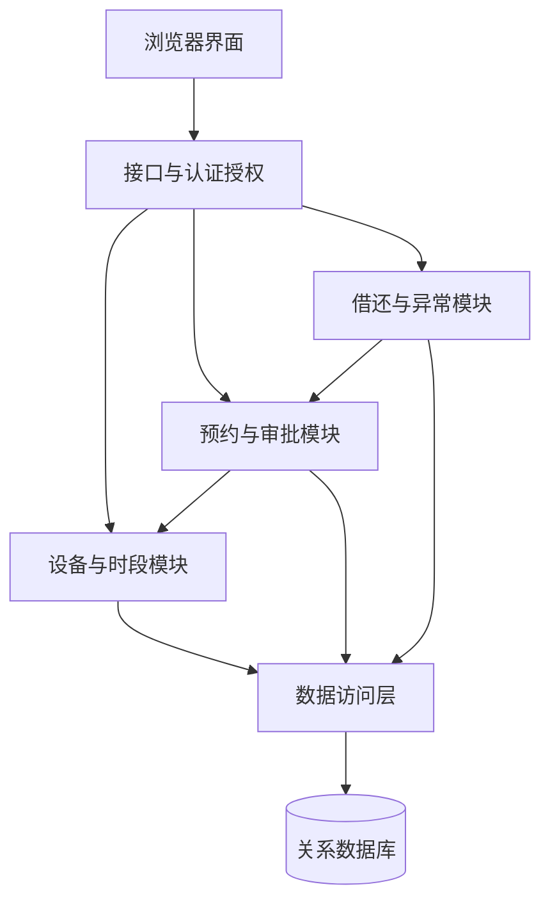

# 九份项目文档模板逐章编写指南

本指南按文件夹里九份 `.doc` 模板的实际正文结构编写，用“实验室设备借用与预约系统”贯穿示范。示例规则与目标需经你们和需方确认；实际结果、测试通过率、签名和评审意见必须在活动完成后填写。

## 一 先建立统一写法

所有文档统一项目名称、成员姓名、需求编号、设备及预约状态、字段名称和版本。建议草稿使用 0.1、0.2，评审后形成 1.0；实际版本规则可自行约定。文件标识可采用 `LAB-PP-PLAN`、`LAB-RD-PRS`、`LAB-SD-ARCH`、`LAB-SD-UI`、`LAB-SD-DB`、`LAB-SD-MODULE`、`LAB-TEST-PLAN`、`LAB-TEST-CASE`、`LAB-TEST-REPORT`。

多数模板的第 0 章都包括：目的、范围、读者、参考文献、术语。目的应说明本文件解决什么问题；范围说明涉及哪些模块及版本；读者写指导教师和开发测试成员；参考文献列实际使用的文件及版本；术语仅保留项目确实使用的词。不要保留没有使用的 SPP 规范缩写来凑内容。

版本历史应写“修改了什么和为什么”，例如“0.2：补充取消后释放时段的规则，并更新对应测试”。封面作者列实际编写者，不能用统一的组长名字代替所有贡献。

### 旧模板清理事项

- 替换 `{项目名称}`、`Company`、`X.Y`、`Year-Month-Day`、机构图标、2002 年页脚等占位信息。
- 原模板里的 Office 2000、Visual SourceSafe、Rational Rose 等是示例，填写你们实际使用的工具及版本即可。
- G-2 的需求评审表预先勾选了“基本合格”，应清除默认结论，实际评审后再填。
- C-2 目录列出项目估计、审批等条目，但正文没有完整逐项展开。先以正文和课程要求整理章节，补上 WBS、估算及风险，再重新生成目录，不照搬旧页码。
- 企业“机构领导”“高级经理”等角色可按课程情境注明对应教师或小组负责人；未发生的审批写待评审，不编造签字或承诺。
- K-2 明确允许按项目实际测试状况裁剪。保留适用项，说明不适用的理由；课程提交范围有疑问时由教师确定。

## 二 C-2 项目计划

**回答的问题：谁在什么时候，用什么资源，完成哪些可验收成果。** A 负责汇总，三人分别估计自己的业务模块；第 1 周起草，每周跟踪修订。

| 模板章节 | 应填写内容 | 示例或检查点 |
|---|---|---|
| 0 文档介绍 | 计划用于范围、资源、进度和变更管理；列需求及课程安排依据 | 不要写成产品功能介绍的重复段落 |
| 1.1 项目范围 | 用户、业务边界、必做和不做的事项 | 固定时段、单台设备、本地账号；不做押金支付 |
| 1.2 项目目标 | 有时间限制且可以验收的目标 | 第 8 周在独立环境完成一次完整借还，并提供真实测试记录 |
| 1.3 客户与最终用户 | 教师或实际需方；学生、设备管理者的使用特点 | 写明调研来源，未知规则列为待确认 |
| 1.4 开发方 | 三人及其职责、组长和联系方式的适用范围 | 与任务清单、个人答辩保持一致 |
| 1.5 制约 | 周期、可用工时、硬件、技术经验、外部依赖 | 不把“8 周”直接当作“8 周全职” |
| 2.1 过程模型 | 小步迭代，每轮需求细化、设计、实现、测试、评审 | 明确每周都产生可验证成果 |
| 2.2 方法与工具 | 面向对象分析、建模、版本控制、任务和缺陷管理 | 写实际工具，不把课程列举工具全部堆上去 |
| 3 人力资源计划 | 每人业务主责、兼任角色、交叉评审 | 避免“一人需求、一人开发、一人测试” |
| 4 软硬件资源 | 开发、测试、运行设备，配置、来源、可用时间 | 数据库、运行时、浏览器版本须最终落实 |
| 5 财务计划 | 实际现金开支与资源来源 | 使用已有设备且无需付费时可写新增现金预算为 0，仍单列人时投入 |
| 6 任务与进度 | WBS、负责人、依赖、估计人时、起止时间、完成标准 | 不只写“第 3–6 周编码” |
| 7 下属计划 | 测试、配置管理、质量与评审、沟通、风险 | 小团队可用附录或短章节引用，避免重复文件 |
| 审批与变更附录 | 实际评审记录、变更内容、影响、结论及新版本 | 未评审不得直接勾选通过 |

建议补充一张风险表和估算说明。WBS 应覆盖软件及文档：例如“预约模块 → 规则确认、接口及事务设计、页面、实现、冲突测试、说明更新”，每个叶子任务控制在容易跟踪的规模。

**完成检查：**总工作量不超过可用容量；关键依赖明确；测试、部署和文档有专门时间；需求变化有处理方式。

## 三 G-2 产品需求规格说明书

**回答的问题：系统要为哪些人完成什么事情，怎样判定满足需求。** 三人各写本模块，A 统一术语；第 2 周形成首个需求基线。

| 模板章节 | 写法 |
|---|---|
| 1 产品介绍 | 描述现有借用方式存在的问题与产品用途；未做调研时写业务假设，不写“调研显示” |
| 2 用户群体 | 学生的申请频率、管理员的处理方式和使用环境；不要仅列三个角色名称 |
| 3 标准或规范 | 预约、审批、取消、借还等业务规则，统一日期与编号规则；只列实际遵循的规范 |
| 4 产品范围 | 明确首版功能、非目标、外部系统边界及排除项 |
| 5 产品角色 | 每种角色可查看、创建、修改、审批哪些数据；描述数据范围 |
| 6 功能需求 | 按设备、预约、借还三个业务域分组，每项有唯一编号；填功能描述、优先级、输入、操作序列、输出、补充说明 |
| 7.1 界面需求 | 按角色展示操作、表单校验、错误提示、键盘可达性、目标屏幕尺寸 |
| 7.2 环境需求 | 浏览器、服务环境、网络条件、依赖可用性；具体版本在选型后固定 |
| 7.3 质量需求 | 写可测试的正确性、性能、安全、可靠性和可维护性目标 |
| 7.n 其他需求 | 数据保留、导入导出、交付与安装要求；无适用事项则说明 |
| 附录 A 建模 | 用例图、领域类图、关键时序图、预约状态图；图中术语与正文一致 |
| 附录 B 需求确认 | 实际评审问题、修订记录和确认意见 |

### 一个完整功能需求示例

| 字段 | 示例内容 |
|---|---|
| 名称及标识 | 提交预约 FR-RES-01 |
| 功能描述 | 已登录学生选择可借设备和开放时段，提交借用申请 |
| 优先级 | 必须 |
| 输入 | 设备 ID、时段 ID、用途；用途草案为 1–200 个字符 |
| 前置条件 | 用户账号有效；设备启用；时段尚未开始且允许预约 |
| 操作序列 | 查询设备 → 选择时段 → 填用途 → 提交 → 系统校验并创建申请 |
| 输出 | 成功返回申请编号和“待审批”；失败返回明确原因，不创建有效占用 |
| 异常分支 | 时段已占用、设备停用、用途缺失、会话失效、重复请求 |
| 补充说明 | 待审批即占用时段；重复提交同一个请求不能形成两条有效申请 |
| 验收标准 | 两个不同学生同时申请同一设备同一时段，最多一个占用成功；取消后可再申请 |

需求层只描述业务结果；数据库锁、唯一索引、接口状态码等实现方案放到设计文档。

### 非功能需求写法示例

以下是待评审的目标，不是实测结果。

| 编号 | 候选要求 | 怎么验证 |
|---|---|---|
| NFR-PERF-01 | 在记录配置的测试机器上，预置 100 台设备、1 万条预约，20 个并发虚拟用户执行列表查询，预热后连续测 5 分钟，响应时间 P95 ≤ 2 秒，错误率 ≤ 1% | 保存脚本、查询条件、原始日志、响应统计及运行环境；不要把虚拟用户数说成每秒请求数 |
| NFR-SEC-01 | 学生不能读取或改变他人的私有申请详情，也不能执行审批操作 | 不同角色直接请求接口验证，不能只看页面是否隐藏按钮 |
| NFR-DATA-01 | 已提交成功的申请在服务重启后可恢复读取；一次申请失败不产生残缺占用 | 重启与故障注入测试，并核对数据库 |
| NFR-INSTALL-01 | 另一名组员在一台符合要求的干净环境中，按手册部署并跑通核心流程 | 留存安装版本、步骤、异常与验收记录 |

**完成检查：**每个必做功能都有前提、成功结果和异常路径；指标包含条件和测量办法；不写“性能良好”“绝对安全”等不可验收的描述。

## 四 I-1 体系结构设计报告

**回答的问题：系统由哪些部分组成，为什么如此划分，它们如何合作。** 三人共同定架构，由 A 汇总，第 2 周初稿。

| 模板章节 | 写法及对应成果 |
|---|---|
| 1 系统概述 | 引用需求范围，概括设备、预约审批、借还三个业务域 |
| 2 设计约束 | 三人周期、部署方式、权限、性能目标、外部服务依赖，引用需求编号 |
| 3 设计策略 | 解释单体分模块的取舍、复用的账号权限、可扩展点与暂不引入的组件 |
| 4 系统总体结构 | 一张逻辑结构图与一张部署图；标清浏览器、后端、数据库，以及通信方向 |
| 5 子系统结构与功能 | 按业务域重复本章；说明模块职责、接口、数据归属和依赖 |
| 6 开发环境 | 开发电脑、运行时、依赖、数据库、建模与调试工具的实际版本 |
| 7 运行环境 | 正式演示机器、服务端口、配置、数据目录和启动方式；区分已验证配置与建议配置 |
| 8 测试环境 | 测试数据、账号、负载工具、与运行环境的差异 |
| 9 其他 | 日志、备份、错误处理、配置管理、已知限制 |

可采用如下逻辑结构，正式交付时按实际系统绘制：

该图是逻辑分层，不代表每个框都要单独部署。角色授权在后端执行，浏览器不能直接连接数据库。跨模块调用尽量通过清晰的业务接口，避免随意修改其他模块的数据。

**完成检查：**每个必做需求能找到归属模块；图与代码组织一致；环境可复现；给出取舍理由，而不仅是堆框架名称。

## 五 I-2 用户界面设计

**回答的问题：用户怎样看懂和操作系统，以及操作失败时怎样继续。** 各人负责本模块页面和交互说明，由 A 统一样式。

| 模板章节 | 要填写的内容 |
|---|---|
| 1 界面设计规范 | 导航、表单、日期、按钮、危险操作确认、错误提示和权限展示规则 |
| 2 界面关系及工作流程图 | 页面唯一编号，例如 UI-ASSET-01、UI-RES-01、UI-LOAN-01；画清页面跳转与角色路径 |
| 3 主界面 | 主导航、当前用户角色、待办、主要入口；逐项说明可操作对象 |
| 4、5 子界面 | 按实际页面扩展章节：设备列表、详情、申请、我的预约、审批、领用、归还、异常及统计 |
| 6 美学设计 | 说明布局、字体和颜色用途；错误提示不能仅靠颜色区分 |
| 7 界面资源 | 图标、图片来源及使用许可、复用组件和空状态图 |
| 8 其他 | 小屏适配、键盘操作、加载状态、无权限及网络错误处理 |

每张页面图至少配一张控件说明表：控件编号、含义、数据来源、输入限制、可用条件、触发操作和异常提示。

例如预约页：设备名只读；时段只展示开放项；用途不能为空；提交中禁止重复点击；冲突时保留用途并提示重新选时段；提交成功跳转详情。禁用按钮只是改善体验，服务端仍需处理并发和重复请求。

**完成检查：**有正常、空数据、加载、失败和无权限状态；最终版本截图与实际软件一致；原型阶段的示意图明确标注。

## 六 I-3 数据库设计报告

**回答的问题：数据如何保存、关联、约束和恢复。** B 维护统一模型，各人描述自己负责的数据。

| 模板章节 | 应填写内容 |
|---|---|
| 1 数据库环境 | 实际数据库及版本、字符集、时区、连接和迁移方式 |
| 2 命名规则 | 表与字段命名、主外键、时间字段、索引命名；代码中的名称同步 |
| 3 逻辑设计 | ER 图、实体含义、关系和基数，解释一台设备对应多个时段和多个历史预约 |
| 4 物理设计 | 表汇总；逐表列字段、类型长度、可空性、默认值、主外键、唯一及检查约束、索引 |
| 5.1 数据访问 | 通过后端访问、数据库账号最小权限、测试与运行配置分离 |
| 5.2 密码处理 | 使用合适的加盐密码哈希，说明所选库及配置；禁止保存明文或可逆密码 |
| 5.3 角色权限 | 业务角色可访问的数据范围和操作；与数据库连接账号权限分开说明 |
| 6 优化 | 针对查询条件设计索引，以实际执行计划和测量说明效果；不要凭空声称提升百分比 |
| 7 管理维护 | 初始化、迁移、种子数据、备份、恢复、数据清理和历史记录保留 |

旧模板把密码存储称为“加密”，实际应采用密码哈希；OWASP 将哈希作为密码校验的合适方式，强调使用专门的密码哈希算法。[OWASP 密码存储指南](https://cheatsheetseries.owasp.org/cheatsheets/Password_Storage_Cheat_Sheet.html)

### 推荐项目的候选表

| 表 | 作用及关键约束 |
|---|---|
| users | 用户账号，用户名唯一，保存密码哈希和账号状态 |
| roles、user_roles | 角色及用户角色关联；若首版单角色可简化，但各文档需一致 |
| equipment_categories | 设备分类 |
| equipment | 每台设备的唯一编号、类别和启停状态 |
| reservation_slots | 设备和日期时段，设备与时段组合唯一 |
| reservations | 申请人、时段、用途、状态、请求标识；请求标识按约定范围唯一 |
| active_slot_claims | 当前占用，slot_id 唯一且 reservation_id 唯一；历史预约单独保留 |
| approval_records | 实际审批人、结论、时间和原因 |
| loans | 领用与归还，应还时间，一次预约至多生成一条借用记录 |
| equipment_incidents | 损坏或异常记录及处理结果 |
| audit_logs | 关键操作记录；避免记录密码等敏感内容 |

占用表方案是一个候选实现：在同一事务中创建申请并插入占用，唯一冲突则整体回滚；取消、拒绝或失效时，在同一事务中变更申请并释放占用。不要把 `(设备, 时段)` 的唯一约束直接加到全部历史预约上，否则取消后仍可能无法重订。

**完成检查：**每个页面需要的数据有来源；历史数据不会因取消而消失；约束能防住重复占用；迁移脚本与表说明一致；备份后实际做过恢复验证。

## 七 I-4 模块设计报告

**回答的问题：每个模块的接口和内部逻辑如何实现。** 三人分别完成业务章节，B 复核公共接口。

| 模板章节 | 写法 |
|---|---|
| 1 模块命名规则 | 类、接口、方法、变量、文件及错误码规则 |
| 2.1 模块汇总 | 每个模块的职责、所属业务域、负责人和对应需求 |
| 2.2 模块关系图 | 展示调用和依赖，与体系结构设计保持一致 |
| 3、4 各子系统设计 | 按实际模块扩展，每个模块填功能、接口属性、数据结构算法、异常及补充说明 |
| 5 其他 | 并发控制、幂等、日志、设计模式和限制 |

每个接口建议记录：名称、参数类型及范围、调用权限、返回值、业务错误、读写数据、事务边界。复杂模块补类图、时序图或决策表；不需要把全部源代码贴进报告。

### 预约模块设计示例

`submitReservation(actor, slotId, purpose, requestId)`：actor 从已认证上下文获得，不能相信请求体自报身份；slotId 指向开放时段；purpose 按需求校验；requestId 用于同一用户同一请求的重复提交识别。

建议流程：

1. 检查登录、权限和输入；已存在的相同请求返回原结果，若同标识但内容不同则拒绝。
2. 开启事务；锁定相关设备或采取等效的一致性控制，重新检查启用状态、时段与时间。
3. 写入待审批申请及唯一时段占用。占用冲突时回滚，并返回业务冲突。
4. 同事务写关键操作记录，提交后返回申请编号。

设备停用操作也要遵守相同的并发约定，否则可能发生“检查通过后设备被停用、申请仍创建”的竞态。取消与审批通过锁定申请或按旧状态进行条件更新，防止同一申请被重复流转。

**完成检查：**正常和异常分支都能指导实现；事务与状态规则清楚；类图、方法名和实际代码能对应；说明为什么采用某种模式。

## 八 K-1 系统测试计划

**回答的问题：要测什么，如何测，谁测，达到什么条件可以交付。** C 汇总，三人共同设计；第 2 周起草，第 5 周冻结主要范围。

| 模板章节 | 应填写内容 |
|---|---|
| 1 范围与主要内容 | 需求编号、模块、功能及非功能测试，明确范围外项及原因 |
| 2 方法 | 等价类、边界值、状态迁移、权限矩阵、接口与端到端、并发及回归 |
| 3 环境与辅助工具 | 软件版本、机器配置、网络、测试数据、账号、脚本及报告路径 |
| 4 完成准则 | 预先约定的通过条件、缺陷限制、未覆盖项处理 |
| 5 人员与任务 | 每人负责设计和执行的测试、交叉验证人、时间 |
| 6 缺陷与改错 | 新建、确认、分配、修复、回归、关闭或重开；严重程度与优先级 |
| 附录审批 | 实际计划评审记录 |

建议完成准则：所有已承诺的核心需求用例执行并通过；无未关闭的阻断或严重缺陷；权限、重复占用和数据完整性测试全部通过；目标环境部署成功；性能按已确认要求验证；其他未通过项逐条评估并记录交付意见。

原模板“功能 100%、非功能 95%”是示例，不能机械使用：一个权限漏洞不能因为其余测试通过而被百分比掩盖。指标如被教师指定，则遵循并同时报告关键缺陷情况。

补充进入条件：候选版本可安装，核心接口稳定，数据可复位，测试环境明确。若关键服务不可用导致无法测试，记录阻塞并安排恢复后重测，不能算作通过。

## 九 K-2 测试用例

**回答的问题：另一名组员能否按记录复现测试，并判断对错。** 各人先写本模块用例，再交叉执行。

模板包含九类，建议这样对应：

| 原章节 | 本项目的具体内容 |
|---|---|
| 1 接口与路径 | 参数缺失、边界、错误类型；预约服务的成功、冲突、回滚和非法状态分支 |
| 2 功能 | 正常借还、拒绝、取消、重订、设备停用、统计口径 |
| 3 健壮性 | 重复请求、网络中断、数据库异常、非法操作顺序和错误恢复 |
| 4 性能 | 约定负载下的延迟、吞吐及错误率，记录平均值并补 P95 |
| 5 图形界面 | 表单提示、状态显示、键盘、窗口尺寸、空数据、长文本 |
| 6 信息安全 | 未登录、学生调用管理员接口、访问他人申请、越权修改 |
| 7 压力 | 逐级提高负载，观察错误与恢复，和“目标负载是否达标”的性能测试分开 |
| 8 可靠性 | 连续运行、服务重启后数据一致性、备份恢复；无故障的短测试不能推出全年可用率 |
| 9 安装与反安装 | 干净环境初始化、配置缺失、端口占用、停止服务与数据保留；无升级功能则明确标注不适用 |

各类共有的“对象、目的、环境、驱动程序”可引用统一环境说明，具体测试仍标记版本；手工操作时“驱动程序”写手工步骤及所需辅助工具，不编造一个不存在的程序。

建议在原表基础上补充：用例 ID、需求 ID、优先级、前置数据、步骤、预期、实际、状态、执行人、日期、版本、证据和缺陷 ID。

### 可直接改写的测试设计示例

| 用例 ID | 前提及动作 | 预期结果 | 实际结果 |
|---|---|---|---|
| TC-RES-001 | 启用设备、未来空闲时段、学生 A 登录，提交有效用途 | 产生一条待审批申请和一条占用，能在我的预约查看 | 未执行 |
| TC-RES-002 | 用途为空；提交同一时段 | 拒绝并提示用途必填，没有新申请和占用 | 未执行 |
| TC-RES-003 | 用途为 200 字符和 201 字符分别提交；每次重置数据 | 前者按规则接受，后者拒绝；最终以已确认长度规则为准 | 未执行 |
| TC-RES-004 | 学生 A、B 用同步屏障同时发送不同请求，申请同一空闲时段 | 最多一个成功；一个有效占用；失败方明确知道冲突 | 未执行 |
| TC-RES-005 | 同一学生以相同 requestId 重复发送完全相同的有效请求 | 返回同一申请结果，不新增第二条记录 | 未执行 |
| TC-RES-006 | A 取消自己的待审批申请，B 再申请原时段 | A 历史为已取消；旧占用释放；B 可申请 | 未执行 |
| TC-SEC-001 | 学生 A 直接请求管理员审批接口 | 拒绝操作，状态不变，有合适的错误响应 | 未执行 |
| TC-SEC-002 | A 请求查看或修改 B 的私有申请详情 | 不泄漏 B 的私有详情，不修改 B 的申请 | 未执行 |
| TC-STATE-001 | 管理员尝试领用尚未批准的申请 | 拒绝，无借用记录，原状态不变 | 未执行 |
| TC-REC-001 | 成功提交后重启后端，再查询申请 | 已提交数据存在，状态和占用一致 | 未执行 |

真正执行时，应将示意条件换成明确的测试账号、设备编号、时段和日期；并发测试记录重复次数及每次结果。实际结果不能复制预期列。失败时保存响应、日志、截图及相关记录；修复后关联回归结果。

## 十 K-3 测试报告

**回答的问题：哪个版本实际测试了什么，结果怎样，能否交付。** C 汇总三人的真实记录，第 6 周开始形成，最终候选版本回归后定稿。

| 模板章节 | 应填写内容 |
|---|---|
| 1 基本信息 | 测试计划和用例版本、被测构建或提交标识、环境、数据、脚本、执行人和时间 |
| 2 实况记录 | 各用例执行状态、实际结果、证据、缺陷 ID；明确统计口径 |
| 3 分析与建议 | 未通过需求、遗留缺陷、风险、性能是否达标、交付建议及限制 |
| 4 缺陷修改记录 | 根因、修改者、修复版本和时间、回归人及结果；使用工具报表时可附导出 |
| 附件 | 原始测试记录、脚本、日志、性能报表、关键截图和追踪矩阵 |

统计时设总计划数 N，通过 P、失败 F、阻塞 B、未执行 U，保证 N=P+F+B+U。可以同时报告“完成判定比例 (P+F)/N”“已判定用例通过率 P/(P+F)”和“全部计划用例通过比例 P/N”；分母为 0 时写不适用。重复执行的回归记录另列执行轮次，不反复计入唯一用例总数。

不要预先写“全部通过”“系统稳定可靠”“无任何缺陷”。若没有真实运行软件，报告只能先建立框架，所有实际结果保留待执行；本指南中的示例均未执行。

## 十一 一条需求如何贯穿九份文档

| 文档 | 同一条预约冲突需求应出现的内容 |
|---|---|
| 项目计划 | 预约冲突任务由 B 负责，第 3 周完成验证，估计工作量与依赖 |
| 需求说明 | FR-RES-01：同一设备同一时段最多一个有效占用 |
| 体系结构 | 预约模块负责一致性，设备模块提供启用状态，数据库提供持久约束 |
| 用户界面 | UI-RES-01 展示冲突提示，保留已填用途 |
| 数据库 | active_slot_claims 的 slot_id 唯一约束，取消释放与历史分离 |
| 模块设计 | submitReservation 的事务、并发和重复请求处理 |
| 测试计划 | 安排双用户竞争及取消后重订验证 |
| 测试用例 | TC-RES-004、TC-RES-005、TC-RES-006 |
| 测试报告 | 关联被测版本、实际结果、证据和缺陷回归记录 |

最终检查时，从每个必做需求顺着这张表查到证据；反过来，从任一主要页面或数据库表也应能解释其需求来源。
